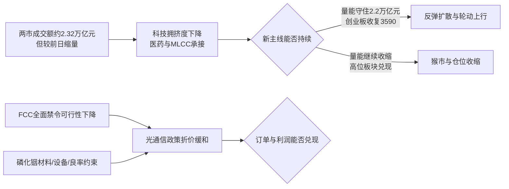

# 📊 每日投资简报 — 2026年8月12日（周三·盘前）

> **数据来源**：雪球（42篇）、微博（24篇）、微信公众号（5篇） | 共 **71 篇**文章
> **覆盖时段**：2026-08-11 08:45 ~ 2026-08-12 08:55（北京时间）
> **覆盖作者**：雪球 13/21 位 | 微博 4/5 位 | 微信 5/5 个
> **生成时间**：2026年8月12日 盘前

---

## 今日三句话

| 项目 | 内容 |
|---|---|
| 今日最重要变化 | 两市成交额维持约2.32万亿元但缩量，医药调研104次超过电子51次，资金由单一科技抱团转向医药、MLCC等轮动。 |
| 对投资假设的影响 | 风险偏好尚未失速，但创业板未收复3590点；后续需同时观察量能能否守住2.2万亿元和新主线能否形成持续承接。 |
| 今日不做什么 | 不因板块单日拉升追高，也不把外资增持或扩产传闻直接等同于基本面兑现（ETF领航员、睿知睿见、淡淡的相思林）。 |

## 零、✅ 上期观察点验证

| 假设ID与关注点 | 关联观点 | 实际结果与证据 | 验证状态 |
|---|---|---|---|
| H-20260806-001：B浪突破创业板3590点、上证3886点并维持量能 | wu2198持续以3590点作为创业板扩展空间门槛 | 8月11日创业板收3549.164点，未过3590；上证收3934.09点，继续高于3886；两市成交额23209.8592亿元，高于22000亿元。证据：E-20260812-001~003。 | ⚠ 部分兑现 |
| H-20260810-001：宇树科技首日市值守住约610亿元且波动放大 | 社交平台关注中签与产业链映射 | 尚缺交易所首日收盘价、换手率和实际流通盘，不能以盘前报价或申购信息替代正式成交。 | ⏳ 待验证 |

## 一、💼 博主持仓信息

| 博主 | 持仓/操作 | 原文摘要 |
|---|---|---|
| 猫笔刀 | 卖出昨日埋伏的电影概念股；长期持有黄金金融产品并做期权/RWA增强 | “把昨天上午埋伏的概念股给卖了”；黄金“过去这些年只有买入，没有卖出”。 |
| 小豆小瓜_ | 家庭资金约80%用于股票、20%理财；延续小市值策略 | “80%的资金用来炒股，20%的用来做理财”；主线难选时继续坚持小市值策略。 |
| 我不会选股2019 | 红利若再涨5%–10%将减仓；总仓位不低于75%；长江电力29.85–30.45元区间计划减仓 | 明确给出减仓纪律，同时披露宁德时代365元以内网格、神火股份分档估值与退出条件。 |
| 诸葛孔暗 | 有色重仓做T后未接回；减持医药/CXO；补足软件ETF计划仓位；约七成仓观察 | “攻击受阻，下半周不能修复，注意减仓回避，手里多留些子弹。” |
| 行中衡 | 持有消费电子；短线参与AI软件 | “持有消费电子是因为亏太多”；“短线搞了点AI软件”。 |
| 陈达美股投资 | 已将两倍美光换为一倍，等待向上动量再买回杠杆仓；长期黄金配置5%–10% | 强调低波动后等待明确动量，避免杠杆损耗；黄金用于保留现金选择权。 |

## 二、📡 博主看好方向汇总

| 博主 | 看好方向 | 看空/回避方向 | 操作建议摘要 |
|---|---|---|---|
| ETF领航员 | 创新药、MLCC、算力硬件、机器人 | 前期涨幅较大的贵金属/有色，拥挤科技ETF | 主线分歧低吸，不追热门脉冲。 |
| 三岁小怪兽 | 创新药趋势、具基本面支撑的To B软件 | 高估值商业航天；光模块长期估值受政策折价 | 中际旭创更应按短期业绩给估值。 |
| 柯中投研笔记 | 锂电去库、光伏/光模块政策缓和后的修复 | 无基本面支撑的有色博弈、存储目标价下调风险 | 指数若继续调整则形态转弱，关注周五节奏。 |
| 热点投研 | 磷化铟龙头、光通信头部企业 | FCC全面禁令叙事、低门槛扩产故事 | 关注材料短缺、良率和真实产能爬坡。 |
| 猫笔刀 | 黄金长期配置、红利时间补偿、恒生科技规则更新 | 电影票房概念追涨 | 选择有现金流或可获得时间补偿的品种。 |
| Value_at_Risk | 未明确看多，关注医药机构调仓 | 警惕医药再次形成拥挤抱团；质疑回购能扭转港股趋势 | 不把资金流入直接等同于后续收益。 |
| wu2198 | 创新药、生物制品、MLCC、电容、局部科技 | 创业板未收复3590前不确认扩展空间 | 上证看3922–3986，创业板以3590为关键门槛。 |
| 唐史主任司马迁 | 有基本面阿尔法且筹码阻力小的方向 | 纯题材微盘小盘、无基本面补仓 | 猴市打法，碎片交易、错了先跑。 |
| 挖地瓜的超级鹿鼎公 | 足够便宜且有分红的芯片、光通信、内存 | 电解铝高波动追涨 | 价格与分红优先于赛道标签。 |
| 九洲仙人 | 创新药、美股宽基ETF；油气与铝作对冲 | 高波动主题追涨 | 多数人以宽基ETF获取更高胜率。 |
| 买股票的老木匠 | 医药生物机构关注升温 | 未明确表态 | 转述公募仓位94.34%及医药调研热度提升。 |
| 古董鱼 | 机器人核心龙头、企业级SSD扩产链 | 把0到1阶段直接折算成供应链利润 | 特斯拉机器人今年内部训练，供应链业绩拉动有限。 |
| 大橘养基桶 | 黄金结构性敞口、科技去杠杆后的指数机会 | 对反弹斜率过高预期 | 盯量能、逢低加仓，创业板优于科创板。 |
| 小豆小瓜_ | 小市值策略、上游半导体设备材料 | 当前存储/光模块继续充当AI龙头 | 高低切接近尾声，等待新主线确认。 |
| 我不会选股2019 | 宁德时代、神火股份等估值可量化标的 | 宇通客车、羚锐制药暂时调出自选 | 用价格区间和仓位上限约束操作。 |
| 淡淡的相思林 | 存储龙头分化、HBM定制化、设备材料约束 | “全行业一荣俱荣”、只看扩产名义值 | 看资本开支执行、股东回报、良率与真实供给。 |
| 睿知睿见 | 低估内需与红利的慢修复 | 盲从外资、期待强刺激、追逐轮动 | 回到估值与盈利，不把机构买入当作投资逻辑。 |
| 行中衡 | MLCC、CXO、AI软件短线 | 科技反弹后半段追高 | 反弹30%–50%后注意撤退。 |
| 诸葛孔暗 | 创新药强于CXO、稳定客户的AI软件 | 有色短线杀跌、高位个股 | 下半周不修复则继续大幅减仓。 |
| 躺红利摊转债 | 核心红利股跟踪 | 未明确表态 | 本期仅更新红利股数据观察。 |
| 陆家嘴幽灵 | 有真实现金流、良率和产能落地的AI企业 | 循环融资、伪需求、高位增发稀释 | AI硬件进入现金流与资本纪律审视阶段。 |
| 陈达美股投资 | AI长期产业、黄金5%–10%、存储低波动后的动量机会 | 长期持有高杠杆ETF、无订单兑现的低估值 | 等订单、产能和向上动量确认。 |

## 三、⚡ 今日注意事项与投资总结

| 项目 | 作者观点归纳 |
|---|---|
| 市场情绪 | 约2.32万亿元成交额下，3700余只个股下跌但仅2只跌停，属于缩量分化而非全面恐慌（ETF领航员、小豆小瓜_）。 |
| 重点事件 | 医药机构调研热度超过电子；FCC光模块限制预期缓和；磷化铟扩产与材料约束同时升温（Value_at_Risk、热点投研）。 |
| 风险提示 | 创业板3590点仍未有效收复，高位有色和科技均存在获利盘；外资买入、名义扩产和融资规模都不能替代现金流验证（wu2198、睿知睿见、陆家嘴幽灵）。 |
| 板块线索 | 创新药/生物制品、MLCC、磷化铟材料、低估红利及具订单兑现能力的AI硬件获得较多关注；均需区分行业贝塔与公司兑现。 |
| 操作共识 | 多数作者强调不追涨、控制仓位、等待量能与基本面确认；对“买了就拿、跌了就补”的纯题材做法分歧最小。 |

---

## 四、缩量反弹进入主线再选择

8月11日市场的核心不是指数大跌，而是反弹第五天后的缩量和内部再平衡。结构化数据口径显示两市成交额仍有23209.8592亿元，上证指数保持在3886点之上，但创业板收盘3549.164点，未满足3590点的确认条件。

> “科技股的拥挤度持续下降，前5%股票成交额占比已经从53%降到48%。”
>
> ——小豆小瓜_（雪球）

> “反弹已经进行了一周……更多是个股自身阿尔法叠加资金的抱团，才可能持续走好。”
>
> ——唐史主任司马迁（微博）

多位作者把当前市场定义为“电风扇”或“猴市”：量能仍高，但愿意追高的资金减少，科技、医药、消费、资源之间快速轮动。诸葛孔暗则把关键点放在年线争夺与下半周修复，若攻击受阻延续，将主动降低仓位。

## 五、医药从补涨转向机构再配置观察

医药是当期最明确的资金迁移线索。材料称8月3日至9日公募机构调研医药生物104次，超过电子51次；创新药、生物制品和医药商业在盘面持续扩散，但作者对“新主线”与“再抱团”存在直接分歧。

> “以前是狗不理，现在热度眼看着就起来了，就怕这些机构大调仓后又是一拥而上。”
>
> ——Value_at_Risk（微博）

> “创新药个股分化巨大，主要还是看公司本身。”
>
> ——ETF领航员（微信公众号）

看多依据是BD出海、业绩兑现与估值修复；反方担忧调研热度上升已转化为拥挤交易。后续不只看指数涨跌，还要看机构调研热度能否持续领先电子，以及创新药相对科技硬件是否保持承接。

## 六、光通信：政策折价缓和，供给瓶颈上移

FCC限制叙事从“全面禁令”转向执行可行性评估。热点投研整理的产业观点认为，中国供应商占美国高速模块供应的较高比例，美国云厂商短期缺少替代产能，政策更可能聚焦认证、固件和板载逻辑审核。该判断仍属于产业与机构观点，尚不能当作最终政策事实。

与此同时，市场把关注点上移到磷化铟衬底。JXAM远期扩产20–30倍的预期与管理层7–10倍计划形成落差，但红磷、铟、高端设备、炉子调试和良率爬坡都限制短期供给。

> “行业扩产的进度会低于预期，缺口清晰。”
>
> ——热点投研（微信公众号）

> “如果赚的钱全部再次投入经营中，那么不过就是踏入新一轮的周期循环罢了。”
>
> ——淡淡的相思林（雪球）

因此，光通信的核心矛盾已从简单的政策利空，转为“需求高景气能否穿透政策折价，以及上游材料紧张能否转化为利润和股东回报”。

## 七、存储扩产与真实供给仍然错位

SK海力士大连NAND扩产约50%的消息带来供给担忧，但古董鱼称实际新增不足5万片且要到明年底全部投产；淡淡的相思林进一步指出，多家存储厂资本开支执行慢于计划，设备与零部件也面临共同抢产能。

> “客户改变配置是因为供给不足而非价格……总体需求仍在快速上升。”
>
> ——淡淡的相思林转述美光高管交流（雪球）

这里的分歧不是“扩不扩产”，而是名义规划、实际投产、良率、客户认证和自由现金流之间的时间差。当前活跃假设H-20260806-004已覆盖存储公司分化，本期不重复新增同义假设。

## 八、黄金、有色与红利：长期逻辑遇到短期兑现

黄金外盘接近高位时，A股贵金属与有色出现明显回撤。柯中投研笔记认为铜等品种的下跌带有量化与提前博弈色彩；诸葛孔暗则看到有色杀跌量能凶猛，选择不接回早盘T出的仓位。

> “黄金我过去这些年只有买入，没有卖出……更多的都是金融产品形式持有。”
>
> ——猫笔刀（微信公众号）

> “如果还能涨5%到10%，会一次性降低不小的仓位。”
>
> ——我不会选股2019谈红利（雪球）

长期配置派强调央行购金、法币贬值与时间补偿；交易派则强调高位兑现和仓位纪律。两者并非简单多空对立，而是期限与现金流要求不同。

## 九、AI融资从“钱够不够”转向“回报能否覆盖资本成本”

英伟达提出的5000亿美元安排被材料解释为未来数年的第三方募资目标，而非已经到位的现金。市场的负面反馈集中于循环融资、残值担保和真实算力租赁现金流。

> “AI硬件投资的盲目扩张期已经结束，市场正步入更严格的审视阶段。”
>
> ——陆家嘴幽灵（雪球）

> “低估值本身不构成上涨的充分条件；需持续跟踪订单兑现与产能释放节奏。”
>
> ——陈达美股投资转述买方观点（雪球）

该主题与活跃假设H-20260806-005的“估值锚转向自由现金流和投资回报率”高度重合，因此本期只更新材料，不另建重复假设。

## 十、恒生科技指数寻求扩容纠偏

多位作者提到恒生科技指数拟从30只扩至50只，并增加AI、航天、量子、脑机接口和先进材料等主题。支持者认为这能降低传统互联网权重、修正“错过硬科技”的结构；谨慎者指出新增成分初始权重可能只有约10%，短期影响有限。

> “正式出台估计会在12月……新调入的成份股，占的权重不大，只有10%左右。”
>
> ——小豆小瓜_（雪球）

这一事件具备清晰的官方复核路径：等待恒生指数公司咨询结论、方法论与实施权重，而不是根据社交平台转述提前确认。

## 十一、📋 数据覆盖情况

| 来源 | 已覆盖作者 | 缺失作者 | 覆盖率 |
|---|---|---|---|
| 雪球 | 九洲仙人、买股票的老木匠、古董鱼、大橘养基桶、小豆小瓜_、我不会选股2019、淡淡的相思林、睿知睿见、行中衡、诸葛孔暗、躺红利摊转债、陆家嘴幽灵、陈达美股投资 | DAVID自由之路、suoluos、门捷列夫学徒、柯中、管我财、泡沫艺术家、润哥、冰冰小美 | 61.9%（13/21） |
| 微博 | Value_at_Risk、wu2198、唐史主任司马迁、挖地瓜的超级鹿鼎公 | 谢佩德骨头 | 80.0%（4/5） |
| 微信公众号 | ETF领航员、三岁小怪兽、柯中投研笔记、热点投研、猫笔刀 | 无 | 100%（5/5） |

三个平台当期均有有效文章，完整性门禁已通过。作者缺失只表示本窗口未采集到对应账号内容，不解释为“当日无观点”。

## 十二、🎯 核心矛盾梳理

| 矛盾 | 支持侧 | 反对侧 | 下一步可观测信号 |
|---|---|---|---|
| 医药是否成为新主线 | 调研104次超过电子51次，创新药/生物制品扩散 | 机构再抱团可能迅速拥挤 | 调研排名、板块相对收益、成交占比 |
| 科技是否完成去拥挤 | 前5%股票成交占比53%降至48%，杠杆出清 | 创业板仍未收复3590，缺乏新叙事 | 创业板收盘、两市成交额、龙头更替 |
| 光通信政策与供给谁主导 | 美国短期替代不足，上游材料仍紧 | 长期政策折价和海外扩产仍在 | FCC正式文本、客户订单、InP报价与交期 |
| AI资本开支是否健康 | 第三方资本可扩充基础设施融资 | 循环融资、担保和残值风险抬升 | 利用率、租赁现金流、信用利差、资本成本 |

## 十三、🔭 下期关注（待验证假设）

| 假设（含完整ID） | 支持证据（来源） | 反证信号 | 验证期限 | 复查策略 | 状态 |
|---|---|---|---|---|---|
| H-20260812-001：未来两周医药生物调研热度仍高于电子，创新药与生物制品相对科技硬件维持更强承接 | 医药调研104次并出现公募调仓线索（Value_at_Risk、买股票的老木匠） | 医药调研重新低于电子，且相对表现同步转弱 | 2026-08-26 | weekly | 待验证 |
| H-20260812-002：三季度磷化铟衬底仍受材料、设备和良率约束，至少出现一次可核验的紧张或提价信号 | 扩产预期20–30倍，但红磷、铟、设备与良率限制短期供给（热点投研、淡淡的相思林） | 交期缩短、供给充裕且报价回落 | 2026-09-30 | weekly | 待验证 |
| H-20260812-003：恒生科技指数年末前落实扩容和新主题覆盖，但新增成分初始权重影响有限 | 30扩至50及新科技主题转述；新增权重约10%的判断（三岁小怪兽、小豆小瓜_） | 官方未落地扩容，或新增成分初始权重显著高于约10% | 2026-12-31 | weekly | 待验证 |

---

> **免责声明**：本简报为原始数据的结构化整理，所列观点均来自原作者，不代表任何投资建议。市场有风险，投资需谨慎。
>
> *2026年8月12日 · 数据来源：雪球 / 微博 / 微信公众号*
