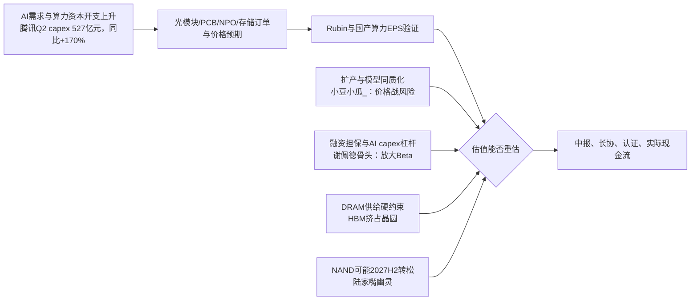

# 📊 每日投资简报 — 2026年8月17日（周一·盘前）

> **数据来源**：雪球（21篇）、微博（7篇）、微信公众号（4篇） | 共 **32 篇**文章
> **覆盖时段**：2026-08-16 08:45 ~ 2026-08-17 08:55（北京时间）
> **覆盖作者**：雪球 10/21 位 | 微博 4/5 位 | 微信公众号 4/5 个
> **生成时间**：2026年8月17日 盘前

---

## 今日三句话

| 项目 | 内容 |
|---|---|
| 今日最重要变化 | 文章共识集中在AI算力、光通信与存储，但科技反弹出现缩量和扩产争议；茅台二季度利润较预期低约10%–12%，消费防御承压。 |
| 对投资假设的影响 | Rubin、国产算力资本开支和存储供给约束仍支持景气与估值重估，但AI融资杠杆、供给扩张及业绩兑现决定持续性，需等待中报与订单验证。 |
| 今日不做什么 | 不把“牛来”票房、宇树暗盘或谐音题材当基本面，不追逐缩量轮动；小豆小瓜_、门捷列夫学徒、猫笔刀等均提示情绪和信息不足风险。 |

## 一、💼 博主持仓信息

| 博主 | 持仓/操作 | 原文摘要 |
|---|---|---|
| 管我财（雪球） | 明确自称京东股东；希望加快 Joybuy 欧洲推进，建议暂停回购京东物流的讨论 | “作为京东的股东，我希望公司能够暂停回购京东物流，把钱加快欧洲的市场推进。” |

> 其余作者在本期材料中未披露可确认的个人持仓、仓位比例或买卖操作；文中出现的“关注”“看好”按方向观点处理，不推断为持仓。

## 二、📡 博主看好方向汇总

| 博主 | 看好方向 | 看空/回避方向 | 操作建议摘要 |
|---|---|---|---|
| 三岁小怪兽（微信公众号） | NPO/光通信、创新药、相对低位中盘股 | 消费等“碳基”板块基本面；缩量权重 | 认为光通信处于景气拐点，医药可作低位试错方向，短期优先中盘股。 |
| 柯中投研笔记（微信公众号） | AI、储能招投标、低估正极材料、存储 | 茅台及消费防御短期二次探底风险 | 以中报验证为试金石，预计业绩释放后8月底出现右侧低点。 |
| 热点投研（微信公众号） | Rubin光模块/PCB/液冷电源、国产算力三支箭、利基存储 | 未明确表态 | 强调三季度从PE转向EPS，跟踪云厂商资本开支、模型适配和晶圆产能。 |
| 猫笔刀（微信公众号） | Anthropic企业应用叙事、伯克希尔持仓信息 | 白酒板块回暖、影视院线基本面 | 将茅台视为可消化但会压制消费回流；提醒宇树暗盘交易违法且不受保护。 |
| Value_at_Risk（微博） | 国内优质创新药 | 未明确表态 | 以日本医保改革经验类比，认为集采2.0后优质创新药超额收益或刚开始。 |
| wu2198（微博） | 未明确表态 | 未明确表态 | 仅转发段永平约191.01亿美元持仓信息。 |
| 唐史主任司马迁（微博） | AI解决方案、海外光存、国产半算、超节点、医药抱团、稀土替代 | 不确定景气公司、脱离真实供需的题材 | “不能确定景气的，一律按照不景气处理”，重视真实供需和中报雷区。 |
| 谢佩德骨头（微博） | AI基础设施长期方向，但不排除Beta风险 | 以融资机制推导出的无条件乐观 | 认为NV残值担保降低融资成本却放大行业成败，5000亿美元投入速度和宏观影响待观察。 |
| 买股票的老木匠（雪球） | 未明确表态 | 未明确表态 | 本期仅记录直播复盘，未给出明确板块或交易方向。 |
| 小豆小瓜_（雪球） | 未明确表态 | 科技反弹上行空间、扩产过多与模型价格战 | 认为反弹接近尾声，关注供给扩张和AI应用需求是否继续爆发。 |
| 淡淡的相思林（雪球） | 海外光存、HBM4E、利基DRAM/NOR/2D NAND、国产存储 | 对“涨价二阶导”刻舟求剑式判断 | 认为供给永久收缩和股东回报支持重估，区分DRAM紧张与NAND可能分化。 |
| 睿知睿见（雪球） | 未明确表态；关注日元、AI资本开支与稀土供给 | 对日本汇率与外债链条风险保持警惕 | 把日元干预、美国融资和全球流动性联系起来，强调宏观尾部风险。 |
| 管我财（雪球） | 京东欧洲业务、资源矿产潜在价值 | 中石化炼化工程盈利与现金流、茅台非标系列 | 关注回购与现金流质量，认为老登股中报可能继续分化。 |
| 行中衡（雪球） | AI光模块高端锡膏、唯特偶/有研粉材/华光新材 | 未明确表态 | 关注三至四季度1.6T验证、国产替代和高排号锡膏放量。 |
| 躺红利摊转债（雪球） | 高股息红利ETF、现金流改善的优质红利股 | 未明确表态 | 认为红利与成长是存量资金跷跷板，短期风格交替。 |
| 门捷列夫学徒（雪球） | AI、光通信、存储、NPO、Scale Across、PCB上游 | 缩量环境下追高和历史K线锚定 | 看好产业升级与龙头集中，强调Q4材料定型和实事求是调研。 |
| 陆家嘴幽灵（雪球） | HBM/服务器DRAM、低估值存储、长协与股东回报 | 对NAND供需转松、AI资本开支金融杠杆保持警惕 | 认为DRAM硬约束仍在，但NAND可能在2027年下半年先分化。 |
| 陈达美股投资（雪球） | 未明确表态 | 未明确表态 | 主要为《牛来》相关回复和文化评论，未形成投资方向。 |

## 三、⚡ 今日注意事项与投资总结

1. **市场情绪**：周末声量仍由科技主导，但雪球和股吧发帖量同比下降约5%，且多位作者提到缩量轮动；这是作者观点归纳，不代表编辑判断（小豆小瓜_、门捷列夫学徒、三岁小怪兽）。
2. **重点事件**：茅台二季度利润较券商预期低约10%–12%，系列酒单季收入同比下降约25%；同时储能8月第二周中标约54GWh，等待业绩与订单验证（柯中投研笔记、猫笔刀）。
3. **风险提示**：英伟达残值担保和AI基建融资降低短期信用成本，却可能放大行业Beta；宇树暗盘黄牛交易被猫笔刀明确提示为非法且不受法律保护（谢佩德骨头、猫笔刀）。
4. **板块机会线索**：Rubin Ultra的NPO/PCB、国产算力、利基存储、1.6T锡膏和创新药是材料中反复出现的线索，但均需以订单、产能、业绩或政策落地验证（热点投研、淡淡的相思林、行中衡、Value_at_Risk）。
5. **作者操作共识**：不追缩量轮动、不用历史K线替代当下信息；对景气不能确认的公司按不景气处理，等待中报和真实供需（唐史主任司马迁、门捷列夫学徒）。

---

## 四、茅台中报低于预期：消费防御承压但非“天塌下来”

| 事实/观点 | 文中数据或论据 | 作者判断 |
|---|---|---|
| 茅台业绩 | 二季度利润较券商预期低约10%–12%；系列酒Q2收入约50.5亿元，同比-25%，Q1为78.81亿元、同比+12.2% | 猫笔刀认为主要是系列酒销售和渠道机制变化，利空但可消化。 |
| 资金与情绪 | 柯中投研笔记称二季度“gjd直接都卖了”，叠加业绩不及预期形成情绪双击 | 可能触发消费和防御方向二次探底。 |
| 现金流对照 | 躺红利摊转债称茅台利润下滑，但中报自由现金流创上市以来新高 | “利润增速承压、现金流优化”可能是优质红利股中报共性。 |

> **柯中投研笔记（微信公众号）**： “这个减仓确实是不太好，叠加业绩落地不及预期就实现了情绪上的双击。对整个消费和防御力方向并不是太友好。”

> **猫笔刀（微信公众号）**： “二季度利润比预期少了10%，肯定是利空，但不是天塌下来的那种坏消息，白酒板块整体在低位，将其消化不是很难。”

分歧不在“是否低于预期”，而在于渠道去库存后能否修复：猫笔刀强调飞天主力产品仍坚挺，管我财则称非标系列从上年同期约180亿元降至约90亿元，且飞天向下挤压其他高端白酒；后续中报、年报是验证窗口。

## 五、Rubin与国产算力：从估值叙事转向EPS和产能兑现

### 5.1 海外Rubin、NPO与PCB的增量叙事

热点投研认为Rubin在三季度主导从PE到EPS的驱动切换：光模块、PCB、液冷、电源自6月持续拉货，7–9月景气加速；Rubin Ultra NVL576的Scale-up/Scale-out网络价值量占比由约4%升至约12%。其测算称，若2028年出货20万柜、其中10万柜采用576卡互联，PCB可能对应两三千亿元市值增量，NPO约一万亿元市值增量。该测算是作者模型，不是已实现事实。

> **热点投研（微信公众号）**： “三季度更应该重视EPS（业绩）端的逻辑，而非PE（估值）端的逻辑。”

门捷列夫学徒补充了更谨慎的产业观察：NPO高封装门槛、Scale Across需要相干光模块且单价约为普通光模块十倍；CPO当前“既没有高于预期，也没有低于预期”，应尊重产业事实。其认为今年Q4材料定型后，M9/M10、正交背板材料和陶瓷基板用量可能决定PCB赢家。

### 5.2 国产算力正循环与验证点

热点投研引用腾讯Q2资本开支约527亿元、同比+170%、环比+65%，并称上半年约847亿元已超过去年全年；中芯国际实际收入约30亿美元、毛利率25%、稼动率94%，华虹收入约7.13亿美元、毛利率16.5%、稼动率102.8%。这些数据在文章中作为产业链论据，后续仍需公司披露与订单验证。

模型侧，文章提到千问3.8、DeepSeek V4 Pro、GLM 5.3在首发或灰度阶段适配多类国产芯片；作者据此提出“模型—云厂商资本开支—前道产能”的正循环，以及AI芯片、Fab厂、超算节点“三支箭”。

> **唐史主任司马迁（微博）**： “坚持AI是解决方案的观点不动摇……光-存是海外的核心，半-算是国产的核心，超节点是GPU产量上升后必然经历的环节。”

### 5.3 看多与看空的具体碰撞

| 作者 | 结论 | 论据/反证 |
|---|---|---|
| 热点投研、门捷列夫学徒 | 🔴偏多：Rubin、NPO、PCB、国产算力仍有产品周期和供给升级 | 拉货节奏、NVL576网络价值量、云厂商资本开支、模型Day 0适配。 |
| 小豆小瓜_ | 🟡偏空：科技反弹空间有限，景气可能接近顶部 | 国内消费电子企业纷纷转做光模块/存储，模型写代码能力趋同，可能进入价格战。 |
| 谢佩德骨头 | 🟡中性偏风险：融资机制降低成本但放大成败 | NV残值回购降低信用风险，却无法规避AI全行业Beta；5000亿美元投入速度未知。 |

> **小豆小瓜_（雪球）**： “上游供给扩大，下游需求遇到瓶颈，并开始卷价格，这是一个不好的信号。”

> **门捷列夫学徒（雪球）**： “没有哪两次历史事件是绝对相似的……正确的作法应该是实事求是的追求极致的调研和重视当下的信息对于决策的权重。”

## 六、存储重估与分化：供给硬约束、长协回报和NAND风险并存

| 方向 | 支持材料 | 需要验证的矛盾 |
|---|---|---|
| HBM/服务器DRAM | 海力士访谈称2027年缺口可能最大；HBM占用晶圆空间约为普通DRAM数倍；HBM4E、Feynman配置预期上修 | 高估值、云厂商资本开支极限、机架内存配置削减是否压制价格。 |
| 利基存储 | 三星、美光等退出成熟产能；2D NAND供给收缩预期40%–50%；南亚科、华邦电表现强 | MLC价格过高可能涨不动，旺宏转产品线和月度涨价需要季度数据验证。 |
| 股东回报与长协 | 闪迪披露8份长期协议、总值约940亿美元、期限4年以上；目标毛利率约80%、超额自由现金流100%返还 | 目标能否在三巨头复制，长协价格下限和AI需求持续性是否兑现。 |

> **淡淡的相思林（雪球）**： “存储即推理，推理即存储。”并称闪迪长期协议把NAND从周期性大宗模式重置为高毛利、低波动的合同模式。

> **陆家嘴幽灵（雪球）**： “高企的PB与低至冰点的PE形成背离，本质上反映了资金对未来盈利持续性的担忧。”其同时判断DRAM紧缺大概率延续，而NAND/SSD可能在2027年下半年先转松。

> **淡淡的相思林（雪球）**： “市场短时可能出现误判，但是如果闪迪的这些目标在其他存储公司同样得到应验，那么整个存储板块是不是应该重估呢。”

三岁小怪兽和淡淡的相思林都指出光存估值或基本面仍有支撑，但小豆小瓜_认为扩产新闻密集、应用需求可能遇到瓶颈；这构成当期最清晰的“供给扩张 vs 需求中枢上移”冲突。

## 七、储能、创新药与高端锡膏：从主题转向订单和政策验证

### 7.1 储能招标和锂电业绩窗口

柯中投研笔记称8月第二周储能中标约54GWh，而第一周不到10GWh；其认为中标比招标更能指引未来9–12个月需求，并提示周一两项业绩（储能相关公司及正极材料）需要市场验证，正极材料环比增长5%以上才算超预期。该判断属于作者的跟踪阈值。

### 7.2 创新药的日本经验映射

Value_at_Risk引用日本90年代医保控费导致医药跑输、十年后鼓励创新并购潮带来独立行情，认为国内集采2.0可能转向鼓励真正优质创新药。三岁小怪兽则从资金博弈角度称医药板块上升、核心龙头创新高，但机构持仓处于2008年以来低位，需防高位震荡和概念股分化。

> **Value_at_Risk（微博）**： “目前国内也开始走入集采2.0时代，开始慢慢转向鼓励真正优质创新药企业的时代，整个优质创新药板块的超额收益或许才刚刚开始。”

### 7.3 1.6T锡膏的国产替代线索

行中衡转述行业交流，认为锡膏复制钻针的成长路径；国内高端光模块锡膏国产化率约1%，1.6T验证预计在2026年三至四季度出现结果。文章给出单只光模块锡膏价值量从400G约6.8元升至NPU/CPU光模块约147元的测算，并列出唯特偶、有研粉材、华光新材。上述为行业交流中的测算和观点，验证点是认证、批量供货、良率与实际毛利，而非仅看市值弹性。

## 八、宏观与跨市场：日元、AI融资和Anthropic估值叙事

睿知睿见认为日元从164附近经干预跌至155后又回到159，汇率干预、美元融资和AI资本开支可能形成相互强化的压力；这是一篇作者的宏观推演，文中没有给出可确认的政策结论。

谢佩德骨头把黄仁勋5000亿美元AI基建融资解释为一种降低风险溢价的金融机制，认为NV提供约25%残值支持可形成“财务成本降—经营风险降—信用评级升”的循环，但也会同步放大行业成功和失败的后果。

猫笔刀整理Anthropic二季度营收约109–115亿美元、同比增长约1360%，年化营收约470亿美元、调整后营业利润约5.59亿美元，并称企业客户收入占比约85%、未来2–3个月可能上市；门捷列夫学徒引用的ARR预测更高，但明确期待IPO披露关键财务模型。两者均属文章信息与判断，不能等同于已实现估值。

## 九、“牛来”热度与题材交易：情绪实验而非基本面锚

猫笔刀称《牛来》累计票房约620万元、单日约550万元，猫眼预测约1800万元；门捷列夫学徒将其视为股民“牛来”愿望的映射；陈达美股投资回复以“妖股式异动、无新剧情、热度退潮”调侃。三者共同提供了情绪样本，但没有形成可交易的公司基本面。

猫笔刀还提到宇树科技场外暗盘约520元、链上挂钩产品约94美元，并明确指出国内黄牛暗盘交易非法、不受法律保护。该部分只能作为风险提示，不能据此推断上市价格或收益。

## 十、📋 数据覆盖情况

| 来源 | 已覆盖作者 | 缺失作者 | 覆盖率 |
|---|---|---|---|
| 雪球 | 买股票的老木匠、小豆小瓜_、淡淡的相思林、睿知睿见、管我财、行中衡、躺红利摊转债、门捷列夫学徒、陆家嘴幽灵、陈达美股投资（10位，21篇） | 诸葛孔暗、DAVID自由之路、古董鱼、suoluos、柯中、泡沫艺术家、九洲仙人、我不会选股2019、大橘养基桶、润哥、冰冰小美 | 47.6% |
| 微博 | Value_at_Risk、wu2198、唐史主任司马迁、谢佩德骨头（4位，7篇） | 挖地瓜的超级鹿鼎公 | 80.0% |
| 微信公众号 | 三岁小怪兽、柯中投研笔记、热点投研、猫笔刀（4个，4篇） | ETF领航员 | 80.0% |
| 抖音 | 无（0篇） | 超级辉 | 0.0% |

> 平台覆盖按 `codex-context.json` 的预期作者统计；抖音当期无文章，因此不能表述为“无观点”或“市场静默”。

## 十一、🎯 核心矛盾梳理

核心矛盾不是“科技是否有故事”，而是故事能否穿过四道验证：

1. **需求**：云厂商资本开支和AI应用是否继续扩张；
2. **供给**：扩产、材料定型和国产替代是否真的造成紧缺；
3. **财务**：EPS、自由现金流和长协底价是否兑现；
4. **交易**：缩量轮动、题材热度和融资杠杆是否先于基本面反转。

## 十二、🔭 下期关注（待验证假设）

本期为普通“生成日报”，未启用假设跟踪，不读取验证材料、不创建新假设。下期仅保留事件观察清单：

| 观察事项 | 支持材料 | 反向信号 | 时间窗口 |
|---|---|---|---|
| 中报对AI、消费、医药和锂电的分化 | 柯中投研笔记、三岁小怪兽、唐史主任司马迁 | 业绩低于预期且无法解释为一次性因素 | 8月下旬 |
| Rubin/NPO/PCB与国产算力订单兑现 | 热点投研、门捷列夫学徒、行中衡 | 拉货、认证或产能数据未兑现 | 三季度至四季度 |
| 存储长协、股东回报与DRAM/NAND分化 | 淡淡的相思林、陆家嘴幽灵 | 长协底价下修、需求放缓或NAND提前过剩 | 2026–2027年 |

---

> **免责声明**：本简报为原始数据的结构化整理，所列观点均来自原作者，不代表任何投资建议。市场有风险，投资需谨慎。
>
> *2026年8月17日 · 数据来源：雪球 / 微博 / 微信公众号*
