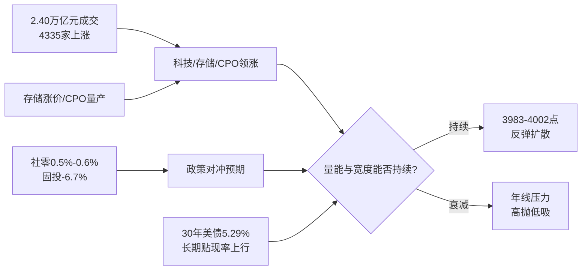

# 📊 每日投资简报 — 2026年8月18日（二·盘前）

> **数据来源**：雪球（45篇）、微博（25篇）、微信公众号（4篇）、抖音（1篇） | 共 **75 篇**文章
> **覆盖时段**：2026-08-17 08:45 ~ 2026-08-18 08:55（北京时间）
> **覆盖作者**：雪球 11/21 位 | 微博 5/5 位 | 微信 4/5 个 | 抖音 1/1 位
> **生成时间**：2026年8月18日 盘前

---

## 今日三句话

| 项目 | 内容 |
|---|---|
| 今日最重要变化 | 8月17日普涨重新点燃“牛来”情绪：两市成交2.40万亿元、4335家上涨、110家涨停，长鑫科技涨12%至4.13万亿元；但上涨仍需后续量能确认。 |
| 对投资假设的影响 | 科技由虹吸转向与有色、食品饮料等共同上涨，短期风险偏好改善；能否站稳3983—4002点并保持2万亿元以上成交，是反弹延续的待验证条件。 |
| 今日不做什么 | 不把单日普涨直接当成牛市反转，不在年线压力附近追涨；诸葛孔暗、大橘养基桶等均强调高抛低吸、控制仓位（作者观点）。 |

## 零、✅ 上期观察点验证

| 假设ID与关注点 | 关联观点 | 实际结果与证据 | 验证状态 |
|---|---|---|---|
| H-20260808-001 A股反弹扩散 | 科技由虹吸转向与有色、食品饮料共同上涨 | 8月17日单日上涨家数和板块扩散改善，但期限要求至8月21日的连续数据；今日无足够证据。 | ⚠ 部分兑现/尚无定论 |
| H-20260808-002 软件业绩分化 | 柯中投研笔记提示规避业绩差标的 | 未取得连续软件公司财报与板块相对收益配对数据。 | ⏳ 待验证 |
| H-20260808-004 稀缺金属供给约束 | 有色为科技之外的观察主线 | 未取得稀土、锗、锑价格、库存、产量或正式政策的连续资料。 | ⏳ 待验证 |
| H-20260810-001 宇树科技IPO首日 | 柯中投研笔记称为“大肉签” | 未取得交易所首日收盘价、换手率和流通盘完整官方记录。 | ⏳ 待验证 |
| H-20260810-002 光模块与PCB分化 | 超级辉、热点投研讨论CPO/NPO；文章未提供FCC最终规则 | SEC资料确认AAOI扩建工厂，但缺少FCC规则与板块资金迁移联合证据。 | ⏳ 待验证 |
| H-20260810-003 科技情绪放量后回落 | 诸葛孔暗警告年线压力、大橘养基桶称反弹未反转 | 8月17日成交放大且普涨，但仅单日，尚未观察到未来一周回落分化。 | ⏳ 待验证 |
| H-20260810-004 FCC逆变器新规 | 本期文章未提供正式规则 | 未发现对应最终规则、项目认证或并网进度证据。 | ⏳ 待验证 |
| H-20260814-001 存储回购注销抬升估值 | 小豆小瓜_、淡淡的相思林看好存储供需 | 检索到美光历史回购授权，未取得截至本日三大厂新增回购及A股估值联合证据。 | ⏳ 待验证 |
| H-20260814-004 降息预期反身性风险 | 睿知睿见提示短端下行、长端不松动 | 美联储官方日程可确认常规会议安排，但Jackson Hole事件窗口尚未完成。 | ⏳ 待验证 |

## 一、💼 博主持仓信息

| 博主 | 持仓/操作 | 原文摘要 |
|---|---|---|
| 我不会选股2019（雪球） | 自有资金将中远海控换成长江电力；实盘不带融资，仓位超过99% | “目前实盘不带融资，仓位超过99%”；交换后约多出对应部分5%的长江电力股权。 |
| 诸葛孔暗（雪球） | 尾盘减持部分超配有色；股指期货仓位已在上周次高点清理 | “我目前除了有色之外，其他仓位不多，几个etf和少量小票而已。” |
| 挖地瓜的超级鹿鼎公（微博） | 主仓减持1%的B股并将分红结汇；朋友推荐标的仅1%仓位 | “主仓减持了1%的B股”；“只有1%仓位，完全不是我的菜”。 |
| 大橘养基桶（雪球） | 文中明确列出科创50ETF、国投白银LOF、黄金股ETF为对比/关注标的，未披露仓位 | “如果前两周根据我们的建议加仓了药、黄金有色或创业板，那我还是会建议大家至少部分止盈。”（未等同于当前持仓） |
| 陈达美股投资（雪球） | 明确提到开盘冲闪迪；AI投资核心为硬件与恒生科技指数 | “我开盘冲了闪迪”；“到了我的AI投资核心，硬件与恒科一起涨的时候，舒服！” |

## 二、📡 博主看好方向汇总

| 博主 | 看好方向 | 看空/回避方向 | 操作建议摘要 |
|---|---|---|---|
| 超级辉（抖音） | 长鑫科技、CPO/硅光、光纤阵列、外置光源、散热 | CPO可能减少DSP、高频高速PCB、结构件、激光器用量 | 关注CPO量产带来的产业链结构变化。 |
| ETF领航员（微信） | 半导体、存储、CPO、算力硬件、农业；长期科创/硬科技ETF | 白酒、消费、传媒短期偏弱 | 赛道ETF避免追高，单赛道仓位不超过三成；宽基可定投（作者策略）。 |
| 三岁小怪兽（微信） | AI硬件、创新药、软件、锂电均有配置；消费困境反弹 | 未明确看空 | 认为科技内部轮动、普涨格局较健康，等待政策对冲内需。 |
| 柯中投研笔记（微信） | 8月底后偏多；创新药、科技持续性较强 | 业绩不佳标的 | 关注缩量上涨能否转为放量，规避业绩差标的。 |
| 热点投研（微信） | CPO/NPO、硅光、无源器件、Socket、保偏光纤、OCS | 未明确看空 | 关注从小批量到大批量的“0-1”质变及出货时间/量级。 |
| wu2198（微博） | 存储芯片、CPO、PCB、GPU、覆铜板、交换机、算力租赁；过去20个月未涨且业绩改善的科技股 | 白酒“连续涨价驱动”模式 | 认为B反向3996、创业板向3806拓展，寻找个股反弹机会。 |
| 唐史主任司马迁（微博） | 新动能、AI及金融科技复合体；认为AI泡沫论已被收入和算力生命周期变化削弱 | 未明确看空 | 关注再平衡资金与日本市场波动，强调资本支持科技创新。 |
| Value_at_Risk（微博） | 康方生物、密尔克卫、奕瑞科技、通策医疗等基本面跟踪标的 | 先健科技、小熊电器；华测导航估值偏贵 | 以半年报验证收入、利润、估值，消费持仓需跟踪月度数据。 |
| 挖地瓜的超级鹿鼎公（微博） | 未明确行业多空；关注煤炭CCI与油价 | 乌克兰袭击油轮或推升油价 | 主仓仅小幅调整，朋友标的严格限制为1%仓位。 |
| 谢佩德骨头（微博） | 未发布宏观方向判断 | 因宏观数据选择暂停周报 | “看了今天公布的宏观数据，我决定不发布本周的宏观周报。” |
| 九洲仙人（雪球） | 小光、PCB、存储中有成长和环比改善者；今世缘Q2 | 地产链成长性；仅靠映射、基本面弱的高估值股 | 认为跌得多反弹得多，提示不要把映射当真。 |
| 买股票的老木匠（雪球） | 未给出A股方向 | 长期美债 | 转述30年美债收益率升至5.29%、2007年以来高位。 |
| 大橘养基桶（雪球） | 食品饮料风险收益比、药、黄金有色、创业板 | 缩量科技追涨 | “今天的反弹…远没有到达反转的范式”，建议此前加仓者至少部分止盈。 |
| 小豆小瓜_（雪球） | 小市值策略、存储；认为科技上涨未吸血 | AI应用若仍只停留在写代码，硬件景气可能见顶 | 认为普涨或可维持两三个月，但科技横盘后小票机会增多。 |
| 我不会选股2019（雪球） | 长江电力、电力、水电；中国移动、国电电力、云天化作半年报跟踪 | 估值和业务不清晰的公司 | 偏好安全、稳定、可预测，按目标价和小仓位分批开仓。 |
| 淡淡的相思林（雪球） | 长鑫、兆易创新、普冉；利基DRAM、SLC NAND、NOR Flash | 未明确看空 | 认为供给永久收缩、DDR4/SLC涨价延续，提示信息真伪需核实。 |
| 睿知睿见（雪球） | 流动性驱动的新兴行业、长鑫、AI硬件 | 10年期美债与债务压力是中期风险 | 认为短期关键是流动性能否持续，抱团股初次反弹通常约两周。 |
| 管我财（雪球） | 具备资产负债表和派息能力的公司；亚朵相对维也纳有经营优势 | 一致B药品价格下行、中石化冠德业绩差 | 以现金流、派息和经营质量筛选，不追逐看不懂的品牌。 |
| 诸葛孔暗（雪球） | 科技国产链、有色；确认突破后再提高仓位 | 年线附近追买、港股创新药弱势 | 3983/3995/4002/4024为观察位；“保持熊市思维，多做高抛低吸”。 |
| 陆家嘴幽灵（雪球） | AI全链路：GPU/ASIC、HBM、光通信、液冷、电力；Anthropic商业化 | 高估值而缺现金流、开源压价和能源约束 | 沿CAPEX流向找瓶颈，重点看自由现金流、订单和商业化。 |
| 陈达美股投资（雪球） | 闪迪、美股存储、硬件与恒科 | 消费难好 | “在通缩的地方消费，在通胀的地方赚钱，在泡沫的地方投资。” |

## 三、⚡ 今日注意事项与投资总结

1. **市场情绪**：普涨与“牛来”叙事显著升温，但大橘养基桶称“这头牛身体还是偏虚”，诸葛孔暗认为尚未一阳改三观（作者观点）。
2. **重点事件**：长鑫涨12%、市值4.13万亿元；贵州茅台中报营收907.03亿元、归母净利445.17亿元，同比-1.95%；7月社零约0.5%—0.6%、固定资产投资同比-6.7%（文章披露口径）。
3. **风险提示**：10年及30年美债利率上行、内需数据偏弱、科技估值拥挤和宽基持续流出，均可能使反弹遇阻；Anthropic的2万亿美元估值还面临开源、能源和留存率检验。
4. **板块机会线索**：存储供给收缩与CPO/NPO量产是最密集的产业线索；创新药、食品饮料、有色及小市值修复是科技之外的观察方向。
5. **作者操作共识**：多数作者不建议在压力位追涨，强调量能、业绩和仓位纪律；但ETF领航员、wu2198、小豆小瓜_对科技主线延续更乐观，形成明确分歧。

---

## 四、2.4万亿元普涨后的关键验证：量能能否把反弹变成突破

8月17日的上涨同时具备“指数突破”和“市场扩散”特征：上证逼近4000点，创业板/双创上涨约3%—4%，4335只个股上涨，110只涨停、1只跌停；但不同作者对这是否是牛市回归结论相反。

| 观察项 | 支持反弹延续 | 谨慎/反方 | 需要观察 |
|---|---|---|---|
| 资金与宽度 | wu2198称成交24025亿元、资金流入597.85亿元；科技未明显虹吸其他板块 | 睿知睿见称短期流动性外溢，诸葛孔暗提示8月宽基持续流出 | 成交能否持续在2万亿元以上，且上涨家数不快速收缩 |
| 技术位置 | 诸葛孔暗给出3983—3995—4002，站稳后再看4024 | 诸葛孔暗、ETF领航员均警告单日突破不等于反转 | 缺口补完后是否出现放量滞涨或2.8万亿元以上异常波动 |
| 结构扩散 | 科技、有色、食品饮料、种业和金融同涨 | 大橘养基桶认为大盘科技仍属超跌反弹，科技估值风险溢价偏低 | 科技是否继续带动非科技，而非重新形成单线虹吸 |

> **诸葛孔暗｜雪球**：“当前指数离得并不远，再多些耐心……要等4024以周为单位站住之后，再考虑将仓位重新推回8成以上。”

> **大橘养基桶｜雪球**：“今天的反弹，依然没有让大盘科技股摆脱超跌反弹的范畴，也远没有到达反转的范式。”

## 五、存储与CPO/NPO：产业验证从叙事转向量产、价格和现金流

长鑫科技大涨、海外闪迪/美光/海力士上涨，使存储成为最强情绪锚；淡淡的相思林引用大摩判断，DDR4 2026年三季度涨价约50%、四季度继续双位数，SLC NAND两个季度涨价均可能超过50%。小豆小瓜_则指出闪迪两周涨80%、美光涨41%，并提醒长协仍取决于下游景气。

热点投研把CPO从“是否量产”推进到出货量与可维护性：英伟达Scale-out CPO预计2026/2027年出货1.5万/10万台，平台OE预计2027/2028年600万/1900万；Socket、保偏光纤、FAU/DFAU被视为增量价值环节。超级辉则强调CPO会减少DSP、高频高速PCB等用量，同时增加硅光、光纤阵列、外置光源和散热需求。

> **淡淡的相思林｜雪球**：“利基DRAM缺口约20%，2027年前无新增产能；……SLC NAND缺口持续扩大。”

> **小豆小瓜_｜雪球**：“如果下游真不行了，长协也不靠谱……后续如果没有除了写代码以外的AI应用爆发，那么AI硬件景气度差不多也就到顶了。”

分歧在于：一方用供给纪律和量产节点支持中期景气，另一方担心估值、应用端兑现和信息真伪。后续应优先核对实际出货、ASP、客户订单及自由现金流，而非只看概念扩散。

## 六、内需与消费：数据偏弱、政策预期与估值修复并存

三岁小怪兽概括为“外热内冷、新强旧弱”的K型分化：7月社零、工业增加值、固定资产投资均不及预期，出口约24%增长支撑总量；其认为市场已对“烂到极致”的内需定价，政策工具可能很快出现。Value_at_Risk提醒消费股持仓者按月跟踪细分数据，并列出小熊电器收入-7%、扣非净利-42%的负面样本。

白酒出现鲜明碰撞：wu2198称贵州茅台半年报净利同比下滑1.95%，连续涨价不可持续；大橘养基桶认为茅台更像高股息红利股，食品饮料风险溢价处于近五年较高分位；诸葛孔暗认为茅台利空没有引发资金从老登全面流入科技。结论仍待后续渠道、销量和现金流验证。

## 七、AI估值与宏观流动性：软件闭环已出现，但长债与开源是硬约束

陆家嘴幽灵引用Anthropic二季度营收超115亿美元、调整后营业利润率约5%、推理毛利率70%—85%，认为AI软件已经出现商业闭环；但2万亿美元估值需接受开源模型压价、能源供给、客户留存和自由现金流检验。唐史主任司马迁也认为AI泡沫论已被云端收入和算力生命周期拉长削弱，关键转向coding之外的新市场。

宏观方面，睿知睿见认为美元走弱、人民币突破带来短期流动性；同时10年、30年美债收益率上行和债务供给形成中期压制。买股票的老木匠转述30年美债收益率升至5.29%，为2007年以来高位。市场因此面临“短期资金推动上涨、长期贴现率抬升压估值”的矛盾。

> **陆家嘴幽灵｜雪球**：“不要追着股价变化去倒推逻辑，而应顺着资本开支的流向去提前锚定利润的蓄水池。”

> **唐史主任司马迁｜微博**：“后续再定价，还是要看迭代后的能力是否能拓展出coding以外的新市场份额。”

## N-3、📋 数据覆盖情况

| 来源 | 已覆盖作者 | 缺失作者 | 覆盖率 |
|---|---|---|---|
| 雪球 | 九洲仙人、买股票的老木匠、大橘养基桶、小豆小瓜_、我不会选股2019、淡淡的相思林、睿知睿见、管我财、诸葛孔暗、陆家嘴幽灵、陈达美股投资（11） | DAVID自由之路、古董鱼、suoluos、门捷列夫学徒、柯中、泡沫艺术家、行中衡、躺红利摊转债、润哥、冰冰小美（10） | 11/21（52.4%） |
| 微博 | Value_at_Risk、wu2198、唐史主任司马迁、挖地瓜的超级鹿鼎公、谢佩德骨头（5） | 无 | 5/5（100%） |
| 微信公众号 | ETF领航员、三岁小怪兽、柯中投研笔记、热点投研（4） | 猫笔刀（1） | 4/5（80%） |
| 抖音 | 超级辉（1） | 无 | 1/1（100%） |

## N-2、🎯 核心矛盾梳理

## N、🔭 下期关注（待验证假设）

本次为历史假设复查，未新增假设；以下保留最能代表当期矛盾的四条，状态以 `verification.json` 为准。

| 假设（含完整ID） | 支持证据（来源） | 反证信号 | 验证期限 | 复查策略 | 状态 |
|---|---|---|---|---|---|
| H-20260808-001：科技虹吸转向医药、有色与中小盘共同承接 | 8月17日4335家上涨；诸葛孔暗称科技未形成虹吸 | 后续上涨家数收缩、科技重新独涨 | 2026-08-21 | 连续交易日比较医药/有色/中小盘相对收益与成交额 | ⚠ 部分兑现/尚无定论 |
| H-20260810-002：AAOI扩产与FCC限制导致光模块/PCB分化 | SEC披露AAOI新建21万平方英尺工厂、计划新增500岗位 | FCC无最终规则或光模块资金未迁移至PCB | 2026-08-24 | 核验FCC正式文件、公司订单及板块成交额 | ⏳ 待验证 |
| H-20260814-001：存储回购注销抬升A股存储估值 | 美光已有回购授权资料；淡淡的相思林引用DDR4/SLC涨价预期 | 三大存储厂无新增回购，A股存储高开低走 | 2026-08-21 | 核验公司公告、ASP/供需与估值变化 | ⏳ 待验证 |
| H-20260814-004：降息预期已打满并存在反身性风险 | 睿知睿见称短端利率下行、长端仍高；美债30年收益率5.29% | Jackson Hole明确鸽派且长端收益率回落 | 2026-08-29 | 跟踪Jackson Hole、美债10Y与USDJPY事件窗口 | ⏳ 待验证 |

---

> **免责声明**：本简报为原始数据的结构化整理，所列观点均来自原作者，不代表任何投资建议。市场有风险，投资需谨慎。
>
> *2026年8月18日 · 数据来源：雪球 / 微博 / 微信公众号 / 抖音*
