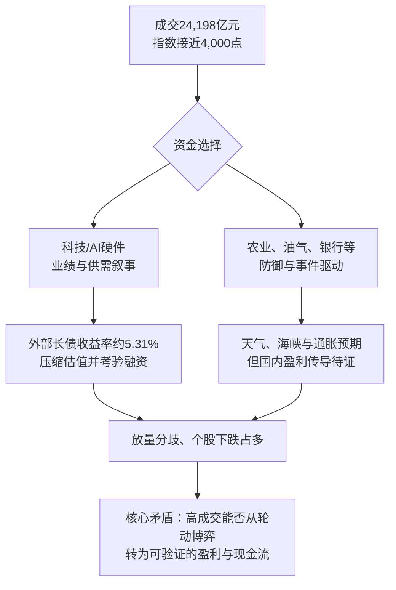

# 📊 每日投资简报 — 2026年8月19日（星期三·盘前）

> **数据来源**：雪球（47篇）、微博（25篇）、微信公众号（5篇） | 补充抖音（1篇） | 共 **78 篇**文章
> **覆盖时段**：2026-08-18 08:45 ~ 2026-08-19 08:55（北京时间）
> **覆盖作者**：雪球 14/21 位 | 微博 5/5 位 | 微信 5/5 个
> **生成时间**：2026年8月19日 盘前

---

## 今日三句话

| 项目 | 内容 |
|---|---|
| 今日最重要变化 | 作者材料显示，沪深两市成交额为24,198亿元、较前日增加173亿元，但3,292只个股下跌；指数在4,000点附近的放量分歧与防御板块大涨同时出现。 |
| 对投资假设的影响 | 对高估值AI硬件的影响偏向风险偏好与估值折现端：美国30年期国债收益率约5.31%成为外部压力锚；待验证条件是海外利率与AI资本开支/现金流能否重新匹配。 |
| 今日不做什么 | 不把农业和“牛字辈”异动等同基本面趋势，也不在4,000点压力区追逐放量轮动；这是冰冰小美、wu2198、唐史主任司马迁等作者的风险纪律归纳。 |

## 零、✅ 上期观察点验证

| 假设ID与关注点 | 关联观点 | 实际结果与证据 | 验证状态 |
|---|---|---|---|
| H-20260812-001 医药调研与相对强度 | 医药能否持续强于电子 | 同花顺基金频道援引公募排排网称8月3日至9日医药生物调研逾100次、位居首位；但缺少同窗口电子、主动基金配置和相对收益配对数据。 | ⏳ 尚无定论 |
| H-20260812-002 InP供需与价格信号 | AI光通信材料约束 | JX Advanced Metals 6月公告拟四年投资最多1,200亿日元、称持续收到增供请求并计划讨论价格修订；未取得Q3实际现货紧张或提价记录。 | ⏳ 尚无定论 |
| H-20260812-003 恒生科技指数调整 | 扩容与新科技主题覆盖 | 恒生指数公司8月10日已启动方法论调整咨询，涉及扩大主题覆盖、优化选样和增加成分；尚无实施结论、成分及权重。 | ⏳ 尚无定论 |

## 一、💼 博主持仓信息

| 博主 | 持仓/操作 | 原文摘要 |
|---|---|---|
| 我不会选股2019（雪球） | 明确计划卖出中远海控，换回长江电力 | “今天打算把中远海控全部抛出回长江电力了”。 |
| 我不会选股2019（雪球） | 考虑以每月结余定投红利低波ETF | 偏好大型、分散的产品，初步关注515300，目标年化约8%-10%。 |
| 诸葛孔暗（雪球） | 仓位约5-7成；早盘做有色T；已清科技大仓 | 明确称“安全才是”，不打算继续减仓，但以波段和小票投机为主。 |
| 诸葛孔暗（雪球） | 软件ETF和个股已有下手；医药大仓已无 | 认为软件有反弹逻辑但指数走弱时抗跌性有限；医药利润已有兑现。 |

## 二、📡 博主看好方向汇总

| 博主 | 看好方向 | 看空/回避方向 | 操作建议摘要 |
|---|---|---|---|
| ETF领航员（微信） | 农业、油气、信创、机器人；有业绩支撑的科技细分 | 前期涨幅过大的算力、AI视频；高估值新股 | 认为科技仍是主线但内部轮动快，避免追高。 |
| 三岁小怪兽（微信） | 国产替代软件；创新药相对抗跌线索 | 锂电、业绩预期已充分的标的 | 业绩反馈差时不博弈预期。 |
| 柯中投研笔记（微信） | 储能、光伏的长期需求；有业绩落地的标的 | 预期已充分但业绩未落地的博弈 | 以5日线判断调整，先等市场重视再表达储能观点。 |
| 热点投研（微信） | 无源器件、CPO/OCS链条，重视EPS拐点与产能释放 | 仅靠概念估值、没有业绩支撑的公司 | 认为太辰光、天孚、东田微的二季度数据是观察锚。 |
| Value_at_Risk（微博） | 业绩更好的新经济；其提及的高股息个股 | 将题材名称炒作当作关联的标的 | 认为AI高估值来自流动性与承接容量错配，韩国市场勿追涨杀跌。 |
| wu2198（微博） | 存储芯片、半导体材料与测试 | 4,000点附近重仓追涨 | 3996/4016为上证短线阻力，提示获利减仓与控制仓位。 |
| 唐史主任司马迁（微博） | 回调后的阿尔法研究；软件、航天/机器人事件驱动 | 杠杆与普反后不做功课的持仓 | 普反接近结束，转向基本面与前沿信息的选股。 |
| 冰冰小美（雪球） | 原油/通胀对冲、海外能源；AI芯算的交易线索 | 国内农业基本面叙事、量化拥挤轮动 | 认为市场是筹码博弈，建议量力参与，甚至“10月后再来交易”。 |
| 九洲仙人（雪球） | 未明确单一方向；保留科技观察 | 频繁强弱切换、白酒景气反转预期 | 认为科技仍看美股脸色；未出现放量大跌前避免频繁调仓。 |
| 我不会选股2019（雪球） | 红利低波、长江电力等可预期股息资产 | 估值不够便宜的福耀；经营承压的火电 | 用股息与估值比较做切换，关注确定性。 |
| 淡淡的相思林（雪球） | 存储、兆易创新/长鑫链、中芯国际 | 对存储“缓解”过早定论 | 认为美光需求仍强、2027供需或更紧，但其内容多为作者转述。 |
| 诸葛孔暗（雪球） | 软件回踩后的题材机会；医药持仓的波段 | 防御轮动中右侧追高科技或医药 | 4,000点附近减仓、5-7成波段；关注3975年线。 |
| 陆家嘴幽灵（雪球） | 存储的长期结构性短缺 | 不看现金流与履约能力的AI金融工程 | 区分短期价格博弈与长期供需，同时警惕英伟达担保的或有负债。 |
| 陈达美股投资（雪球） | 百度AI云、昆仑芯、萝卜快跑的重估叙事 | 高利率下高久期资产的估值风险 | 以AI收入、云业务与资本开支的匹配度观察重估。 |

## 三、⚡ 今日注意事项与投资总结

| 维度 | 作者观点归纳与来源 |
|---|---|
| 市场情绪 | 24,198亿元成交额下仍有3,292股下跌，诸葛孔暗认为“放量杀跌和缩量上涨”在关键节点并非良性；市场呈高位轮动和防御化特征。 |
| 重点事件 | 农业受天气、粮食安全和航运/化肥成本叙事驱动；国产软件受Windows替代传言拉升；频准激光单签收益超55万元强化新股情绪。来源：ETF领航员、小豆小瓜_、wu2198。 |
| 风险提示 | 美国30年期国债收益率约5.31%及全球长债抛售，是多位作者共同的外部风险锚；其对科技估值、融资成本与风险偏好的影响仍待数据验证。 |
| 板块机会线索 | 存储链以兆易创新上半年收入115.66亿元、净利润68.57亿元等业绩数据为锚；无源器件作者强调业绩与产能释放，而非概念本身。 |
| 作者操作共识 | 在4,000点/3996附近不追涨、控制仓位、转向基本面与可验证业绩；对农业、机器人、新股等事件驱动行情分歧很大。 |

---

## 四、4,000点放量分歧：指数韧性与个股亏钱效应并存

| 数据/观察 | 材料中的表述 | 含义（作者观点） |
|---|---|---|
| 全日成交 | 两市24,198亿元，较前日增加173亿元 | 交投仍活跃，但不能据此直接判断为增量资金。 |
| 下跌家数 | 3,292只个股下跌；午间一度3,953只下跌 | 指数与平均持股体验背离，轮动造成亏钱效应。 |
| 资金流 | wu2198记录大盘资金流出834亿元 | 作者据此提示控制仓位，属其盘面判断。 |
| 阻力区 | 上证3996/4016、创业板3756/3806 | wu2198的短线技术观察，非确定性预测。 |

> **wu2198（微博）**：“截止15:00两市成交了24198亿元，有3292只个股下跌，大盘资金流出834亿元。”

> **唐史主任司马迁（微博）**：“市场普反阶段接近结束……市场这里如果回调，就是跟着挑选阿尔法的窗口。”

> **诸葛孔暗（雪球）**：“接近4000点阶段的放量滞涨阶段要留意减减仓。”

观点碰撞：

| 立场 | 作者与结论 | 论据 |
|---|---|---|
| 🟡 仍可做波段 | 诸葛孔暗认为8月月线尚有缓冲，维持5-7成做T | 3975年线不破则洗盘尚可；但明确不做右侧加仓。 |
| 🔴 更偏防守 | 冰冰小美认为量化拥挤、海外因子和4,000点压力使市场脆弱 | 农业等突发行情缺乏国内基本面支撑，轮动本身是亏钱效应。 |
| 🟡 转向阿尔法 | 唐史主任司马迁不简单看多空，而是建议普反后研究基本面 | 流动性、长债成本与AI ARR口径共同抬高了选股难度。 |

## 五、农业、防御与“牛来”情绪：天气叙事不等于业绩趋势

材料将农业大涨与厄尔尼诺、粮食安全、油价及化肥成本联系起来；但多名作者同时质疑国内农业股能否把海外粮价叙事转化为可持续盈利。

| 作者 | 结论 | 论据/边界 |
|---|---|---|
| 柯中投研笔记（微信） | 年底至明年初厄尔尼诺或显现，商品影响通常滞后4-8个月 | 认为资金已开始抢跑；这是作者对时间传导的判断。 |
| 小豆小瓜_（雪球） | 农业本轮气势可能不同，但自己对该板块一贯谨慎 | 引用大摩粮食危机预警与食品通胀预期；未给出个股结论。 |
| 冰冰小美（雪球） | 国内农业没有相同增长路径，更多像量化驱动融资市投机 | 指出国内外粮价与化肥价格差异，认为农业强势反而不利后续市场。 |
| ETF领航员（微信） | 农业、油气为避险/政策驱动的强势板块 | 同时提醒农业“牛字辈”炒作存在名称玄学与短期化风险。 |

> **冰冰小美（雪球）**：“国内农业股没有增长途径，那么农业企业融资，只能借助消息炒作拉升。”

> **小豆小瓜_（雪球）**：“农业这块我研究的不多……这波气势有点不一样，可能某些品种真会走出强势行情。”

## 六、AI硬件与存储：业绩兑现、供需叙事与高利率折现的拉扯

| 线索 | 当日材料 | 需要继续观察 |
|---|---|---|
| 国内业绩 | wu2198称兆易创新上半年收入115.66亿元、净利润68.57亿元；淡淡的相思林提示其对长鑫DRAM采购19.86亿元超原预计额度。 | 订单、毛利率与采购/供给约束能否持续。 |
| 海外供需 | 淡淡的相思林转述美光需求增强、2027供需或比2026更紧；陆家嘴幽灵认为HBM挤占传统DRAM产能。 | 长协定价、资本开支、实际出货和价格，而非单一会议表述。 |
| 估值风险 | Value_at_Risk称新经济承接不了旧经济流出的同等资金量，估值会被流动性推高。 | 增长能否消化估值；外部长债收益率是否继续上行。 |
| AI融资 | 陆家嘴幽灵讨论英伟达对数据中心的最高1,050亿美元信用担保。 | OpenAI等终端租户的真实现金流、履约和或有负债。 |

> **热点投研（微信）**：“从不能看估值到能看估值，本质上是EPS有了明显增长。”

> **陆家嘴幽灵（雪球）**：“飞轮与滚轮的区别，关键在于终端AI商业化的投资回报率能否跑赢资本成本。”

> **九洲仙人（雪球）**：“她涨不一定涨，她跌，全世界科技就完蛋了。”

## 七、长端利率抬升：外部融资成本成为科技与风险资产的共同变量

陈达美股投资、小豆小瓜_、睿知睿见及多位微博作者都聚焦美国30年期国债收益率上行；文章材料把原因归为财政赤字、长期国债供给、通胀/油价及AI企业融资需求，但这些解释需与后续官方数据交叉验证。

| 观点 | 作者 | 具体论据 |
|---|---|---|
| 高利率压估值 | 陈达美股投资 | 约5.31%的30年期收益率会抬高长期融资成本，并压缩高估值科技的贴现估值。 |
| 全球资金分流 | 小豆小瓜_ | 认为美债收益率上升会分流股票资金，并提及AI企业发债与美国财政赤字。 |
| 不宜单因子归因 | 九洲仙人 | 认为中国十年期利率本身不足解释科技走弱，更应注意油价、政策与反弹幅度。 |
| 国内相对融资条件 | 唐史主任司马迁 | 认为国内融资成本相对低，但海外长债供需仍是必须服从的外部环境。 |

## 八、医药、锂电与红利：业绩分化下的不同风险偏好

| 方向 | 作者的实质观点 | 关键风险/分歧 |
|---|---|---|
| 创新药 | 三岁小怪兽提及美股生物科技创新高、A股创新药横盘；诸葛孔暗认为医药仍可持仓做T。 | 贝达药业临床利空导致20cm跌停，买股票的老木匠因此认为创新药确定性不满足其要求。 |
| 锂电/储能 | 柯中投研笔记认为储能预期可能被低估；三岁小怪兽则以电池环比数据与市场反馈说明锂电承压。 | 供需、库存、车企“去宁化”及业绩兑现是争议焦点。 |
| 红利与债基 | 我不会选股2019偏好稳定可预期股息；大橘养基桶认为摊余成本法债基仍有需求。 | 低利率压缩套息空间，红利资产仍需估值与行业分散。 |

## 九、📋 数据覆盖情况

| 来源 | 已覆盖作者 | 缺失作者 | 覆盖率 |
|---|---|---|---|
| 雪球 | 14位 | DAVID自由之路、古董鱼、suoluos、门捷列夫学徒、柯中、泡沫艺术家、润哥 | 66.7% |
| 微博 | 5位 | 无 | 100% |
| 微信公众号 | 5个 | 无 | 100% |
| 抖音（补充） | 1位 | 无 | 100% |

## 十、🎯 核心矛盾梳理

## 十一、🔭 下期关注（待验证假设）

本期不新增假设。当前三项到期复查均已完成但尚无定论，避免在高位轮动和跨市场信息未充分验证时为凑数新增观察项。

---

> **免责声明**：本简报为原始数据的结构化整理，所列观点均来自原作者，不代表任何投资建议。市场有风险，投资需谨慎。
>
> *2026年8月19日 · 数据来源：雪球 / 微博 / 微信公众号*
