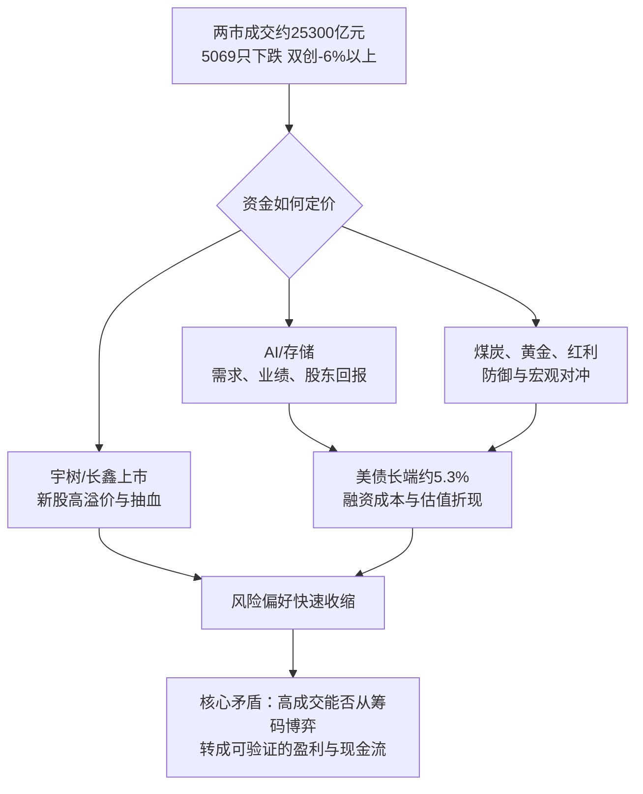

# 📊 每日投资简报 — 2026年8月20日（星期四·盘前）

> **数据来源**：雪球（76篇）、微博（27篇）、微信公众号（5篇） | 补充抖音（1篇） | 共 **109 篇**文章
> **覆盖时段**：2026-08-19 08:45 ~ 2026-08-20 08:55（北京时间）
> **覆盖作者**：雪球 15/21 位 | 微博 5/5 位 | 微信公众号 5/5 个 | 抖音 1/1 位
> **生成时间**：2026年8月20日 盘前

---

## 今日三句话

| 项目 | 内容 |
|---|---|
| 今日最重要变化 | 文章材料显示沪深两市成交额约25300亿元、5069只个股下跌，创业板指跌6.26%、科创50跌6.89%；宇树首日冲高回落与科技板块集体杀跌同时发生。 |
| 对投资假设的影响 | 影响首先落在风险偏好和估值折现：美国30年期国债收益率曾升至约5.3%、AI融资成本与Anthropic收入斜率争议叠加；待验证条件是存储/AI订单和现金流能否抵消利率冲击。 |
| 今日不做什么 | 不把新股首日暴涨、单一海外消息或量化反抽当成趋势反转，不在双创大跌后一次性接满仓；这是ETF领航员、三岁小怪兽、wu2198、诸葛孔暗等作者反复强调的风险纪律。 |

## 零、✅ 上期观察点验证

| 假设ID与关注点 | 关联观点 | 实际结果与证据 | 验证状态 |
|---|---|---|---|
| H-20260806-003 碳酸锂去库由真实需求驱动并形成波段修复 | 柯中投研笔记讨论库存去化、津巴布韦到港和排产；wu2198披露湖南裕能半年报 | SMM口径7月30日库存86911吨、连续12周去库；行业报道引用8月电池排产203.76GWh、环比+8.73%。但证据未覆盖8月20日当周，期货仍交易远期供给转松预期，无法确认“真实需求驱动”和两周波段修复。 | ⏳ 尚无定论 |
| H-20260806-004 存储处于公司分化而非全行业见顶 | 淡淡的相思林、三岁小怪兽、陆家嘴幽灵围绕海力士、美光、HBM与传统DRAM分化 | SK海力士二季度官方材料称AI带动高价值DRAM/HBM、NAND增长且价格环比上涨；三星官方预计下半年服务器、eSSD、HBM需求加速。缺少美光同期官方数据及完整现货/资本开支/营收配对，不能确认全行业未见顶。 | ⏳ 尚无定论 |
| H-20260813-001 ABF膜供需紧张并出现国产验证/订单进展 | 文章材料讨论味之素供给、华正新材CBF、莲花控股纽菲斯及激智科技送样 | 公开产业链信息称华正新材已通过部分载板厂验证并有小批量供货，纽菲斯有中低端批量供货和扩产计划；但未取得味之素正式配额/交期公告及上市公司逐项确认，不能确认四季度前持续紧张。 | ⏳ 尚无定论 |

## 一、💼 博主持仓信息

| 博主 | 持仓/操作 | 原文摘要 |
|---|---|---|
| 我不会选股2019（雪球） | 已将中远海控、中国石油换回长江电力；少量买入天山铝业、神火股份；未来资金考虑定投红利ETF | “昨天已经全部换回长江电力了”；“买了点天山铝业，和神火股份差不多时候开始关注的，仓位极少，打算网格交易”。 |
| 诸葛孔暗（雪球） | 约五至七成仓；指数3920附近加一成、3880附近再加小仓；持有/买入软件、ETF及存储相关ETF；科技大仓已清 | “上午3920开了第一枪，回了一成仓位”；“科技股这里是反弹不是反转”；“尾盘最后竞价阶段买了点存储相关的ETF，仓位不大”。 |
| 九洲仙人（雪球） | 明确提及兆易创新、天孚通信、云铝股份；持有/讨论科创50、创业板指、纳斯达克生物科技、药明康德 | “之前因为被量化恶心到减仓，加仓科技不及时”；“今年没配创新药真是亏啊，完全抄作业”。 |
| 陈达美股投资（雪球） | 明确标的为Moderna、N宇树-W、南方海力士（两倍杠杆ETF） | “40万亿韩元回购全部注销……港股两倍大力也不太感动”；另发文标注Moderna与宇树标的。 |
| 管我财（雪球） | 文章中明确挂出保利物业、永升服务、万物云 | “住房公积金终于可以用来支付物业管理费了”并列出上述物业服务标的；未披露仓位。 |

## 二、📡 博主看好方向汇总

| 博主 | 看好方向 | 看空/回避方向 | 操作建议摘要 |
|---|---|---|---|
| 超级辉（抖音） | 仅认为波动带来机会 | 高位科技与情绪化追涨 | 宇树高开低走、双创大跌后强调保持冷静。 |
| ETF领航员（微信） | 煤炭、银行、农业等防御；有业绩支撑的科技细分 | 高估值算力、机器人、存储及新股首日追价 | 认为科技仍是中期主线但轮动快，避免追高。 |
| 三岁小怪兽（微信） | 医疗服务、白色家电、煤炭、化纤；海外/国产科技择优 | 全线梭哈AI、估值过高的国产科技 | 认为欧美估值较低但有黑天鹅，国产替代估值偏高，继续“骑墙”。 |
| 柯中投研笔记（微信） | 碳酸锂、电池材料、储能的去库与排产；黄金受美债信用扰动 | 高利率下纯融资驱动的AI扩张 | 关注库存、到港和排产的周度变化，不把消息冲击当趋势。 |
| 热点投研（微信） | AI基础设施、算力及高毛利冠军公司；供需紧张的合约价 | 只靠ARR传言、信用保护拥挤的高杠杆标的 | 认为Anthropic ARR低于传言是斜率问题，不等于需求崩塌。 |
| 猫笔刀（微信） | 对宇树商业化质地有兴趣但不等于买入 | 次新股长期持有、首日高溢价接盘 | 以深次新股指数长期表现说明“透支未来”，反对盲目炒新。 |
| Value_at_Risk（微博） | Moderna个体化mRNA肿瘤疫苗、基本面更好的新经济 | IPO首日爆炒、把题材名称当关联、长债供给失控 | 将美债问题归因于供需与债务结构，强调新股长期下跌统计。 |
| wu2198（微博） | 中微公司、存储芯片、半导体材料、湖南裕能等业绩线索 | 3996点附近追涨、未经确认的C杀反抽 | 明确提示控制仓位、等待市场确认C杀是否成立。 |
| 唐史主任司马迁（微博） | 中报超预期、医药mRNA、回调后的阿尔法研究 | 普反尾声仍押注β或题材 | 认为快速下跌后不一定继续大阴线，但也不期待马上阳包阴。 |
| 挖地瓜的超级鹿鼎公（微博） | 宏观财政、国债与商品价格观察 | 纯段子内容不形成投资方向 | 关注美债同步抛售、CCI商品数据及财政可持续性。 |
| 谢佩德骨头（微博） | 宏观、财政和AI资本开支的交叉研究 | 近期不追逐股票热点 | 明确表示最近股票讲得少，研究宏观财政。 |
| 九洲仙人（雪球） | 以美股映射的生物科技、部分科技与深度研究AI | 科技频繁切换、把反弹当反转 | 既给出大二浪ABC的乐观路径，也承认熊市A浪的悲观划分。 |
| 买股票的老木匠（雪球） | 低估值、高现金流及能穿越周期的资产 | 依赖美债救市和高杠杆的AI资本开支 | 把美债回购看作债市救助，要求区分财政与央行扩表。 |
| 冰冰小美（雪球） | 黄金、原油/通胀对冲；少数宏观+业绩方向 | 国内农业的海外粮价映射、量化拥挤和右侧追高 | 强调“量力而行”，认为下跌时不存在天然好股票。 |
| 大橘养基桶（雪球） | 黄金、有色、创新药；非科技和长鑫/存储相对优势 | 把美债回购当成救科技、半导体追底 | 认为反弹仍是超跌反抽，建议分批打子弹、动态止盈。 |
| 小豆小瓜_（雪球） | 对农业、创新药和看跌期权事件保持观察 | 直接追涨高溢价新股 | 记录期权大幅波动，不把单日反转当基本面。 |
| 淡淡的相思林（雪球） | 存储、SK海力士、美光、闪迪及股东回报 | 过早断言存储景气缓解 | 认为海力士40万亿韩元回购对低流动性韩股有强支撑，但仍需验证需求。 |
| 睿知睿见（雪球） | 红利指数、防御资产 | 科技首轮反弹后的追涨 | 认为科技反弹主要由流动性改善而非旧叙事复苏。 |
| 行中衡（雪球） | 苹果折叠屏题材，预计9月底熊市可能结束 | 量化主导、基本面无法解释的短线博弈 | 承认涨10%还是50%取决于小作文和量化，非个人能力。 |
| 躺红利摊转债（雪球） | 中证红利与中证红利质量指数比较 | 未明确看空方向 | 以编制方法、风险收益和估值比较为主，不做个股推断。 |
| 陆家嘴幽灵（雪球） | 具身智能长期商业闭环、存储结构性需求 | 只看故事、不看现金流与履约能力的AI金融工程 | 宇树首日流通盘约7.36%、估值高，短期交易与长期产业逻辑需分开。 |
| 陈达美股投资（雪球） | Moderna、硬件与AI安全研究 | 高久期资产在长端利率上行下的估值风险 | 将OpenAI安全暂停视为利益相关方声明，要求独立验证。 |
| 管我财（雪球） | 公积金支付物业费带来的物业服务关注 | 未明确表态 | 只给出物业服务标的链接，未披露仓位和盈利判断。 |
| 润哥（雪球） | 专注长期财务目标 | 与财务自由无关的噪声和情绪刺激 | “守护好自己的专注力”，未给出具体板块。 |

## 三、⚡ 今日注意事项与投资总结

| 维度 | 作者观点归纳与来源 |
|---|---|
| 市场情绪 | 25300亿元成交却有5069只下跌、逾百股跌停，ETF领航员称“黑色星期三”；三岁小怪兽称“双创-6的大阴线”击穿本轮反弹大半，均属作者描述。 |
| 重点事件 | 宇树发行价150.8元，盘中最高约1100元后收盘约845元；美财政部扩大长期名义国债回购上限、海力士启动40万亿韩元回购，分别成为债市和存储线的边际事件。来源：猫笔刀、Value_at_Risk、淡淡的相思林。 |
| 风险提示 | 美国30年期国债收益率高位、AI公司发债和Anthropic ARR斜率争议，可能同时压缩估值与融资预期；Value_at_Risk另提示美国三季度新债发行计划约7390亿美元，数据仍需官方核对。 |
| 板块机会线索 | 业绩线索包括中微公司上半年净利润同比+300.22%、湖南裕能净利润同比+853.51%、海外mRNA疫苗三期终点达标；这些是材料中的公司/事件信息，不等于推荐。 |
| 作者操作共识 | 多数作者建议控制仓位、分批交易、等待确认；分歧在于诸葛孔暗愿意在3900附近做波段，而大橘养基桶、睿知睿见和冰冰小美更强调反弹未反转。 |

---

## 四、宇树首日冲高回落与双创“黑色星期三”：新股造富和存量资金抽血同屏

| 数据/事件 | 材料信息 | 观察边界 |
|---|---|---|
| 宇树首日 | 发行价150.80元，开盘约1100元，收盘约845元；中一签最高约47.46万元 | 价格来自作者转述，需以后续交易所行情核对。 |
| 盘面广度 | 两市成交约25300亿元，5069只下跌，上涨约400只，创业板指-6.26%、科创50-6.89% | 高成交与普跌并存，不能简单视作增量资金。 |
| 资金结构 | 宇树及长鑫等大盘新股上市，作者认为对存量流动性有抽血效应 | 抽血因果为作者解释，待资金流数据验证。 |

> **猫笔刀（微信公众号）**：“开盘后宇树价格秒跌20%，之后一路下滑，最终收盘845，较开盘价下跌23%。”

> **Value_at_Risk（微博）**：“几乎95%以上的新股在上市后中短期内都是下跌走势。”

> **陆家嘴幽灵（雪球）**：“首日实际可流通的盘子只有约2977万股，占总股本的7.36%……注定会是一场波动较高的情绪博弈。”

观点碰撞：猫笔刀和Value_at_Risk把首日高溢价视为制度与筹码稀缺造成的长期透支；陆家嘴幽灵承认宇树具备批量销售和盈利的商业闭环，但认为约219倍发行市盈率、约36倍市销率必须与现金流和履约能力分开评估。超级辉则只保留“波动才有赚钱机会”的宽泛判断，未给出估值结论。

## 五、长端美债收益率、财政回购与AI融资：估值锚的短期反转不等于风险解除

| 线索 | 作者结论 | 具体论据/待验证 |
|---|---|---|
| 供给冲击 | Value_at_Risk认为美国财政部三季度拟发7390亿美元新债、供给推升收益率 | 需以后续财政部发行数据核对。 |
| 债务结构 | 柯中、Value_at_Risk认为提高长期名义债券回购上限是债务期限结构调整，不等于央行QE | 消息后30年收益率由约5.336%回落至约5.197%为作者盘中记录。 |
| AI融资 | 柯中和热点投研担心高融资成本影响明年资本开支；热点投研认为ARR低于传言主要是斜率和拥挤问题 | 需要看AI公司实际现金流、发债利差和资本开支指引。 |
| 黄金与信用 | 大橘养基桶、冰冰小美认为“越要保美债越说明信用有问题”，黄金受益 | 属作者宏观解释，不替代官方政策结论。 |

> **柯中投研笔记（微信公众号）**：“30年高国债收益，也意味着融资成本也是持续攀升……对明年资本开支的预期影响必然是很大的。”

> **大橘养基桶（雪球）**：“不是救股市！不是救科技股！是救美债。”

> **买股票的老木匠（雪球）**：“美国国债，被全世界认为信用和流动性最好的资产，但现在已经沦为需要靠救市来维持其价格。”

## 六、AI与存储：结构性需求仍强，但国内交易拥挤和股东回报造成分化

SK海力士官方二季度材料称高价值DRAM/HBM与NAND需求强、价格环比上涨并按客户需求分阶段扩产；三星官方预计下半年服务器、eSSD和HBM需求加速。这支持“结构性景气仍在”，但不自动证明全行业没有见顶。文章作者还提到海力士40万亿韩元回购、闪迪回购和长鑫上市，导致海外龙头股东回报与国内估值体系出现比较。

| 立场 | 作者与结论 | 论据 |
|---|---|---|
| 🟢 结构性看多 | 淡淡的相思林、陆家嘴幽灵 | HBM挤占传统DRAM产能；海力士回购约占韩股日成交较高比例；终端AI需求仍扩张。 |
| 🟡 业绩验证 | wu2198、九洲仙人 | 中微公司净利同比+300.22%；兆易创新、天孚通信等被列为观察标的，但要求订单和业绩确认。 |
| 🔴 估值/流动性谨慎 | 三岁小怪兽、睿知睿见、冰冰小美 | 国内科技估值偏高、量化拥挤，科技“只要跌就是全线跌停”；反弹更多由流动性而非叙事复苏驱动。 |

> **三岁小怪兽（微信公众号）**：“最近硬科技龙头密集上市，要注意行业龙头对板块个股的虹吸现象。”

> **睿知睿见（雪球）**：“科技股的首轮反弹已经达到历史中位数水平，随时都可能再度下跌。”

## 七、锂电、医药与红利：基本面线索与交易节奏的分歧

| 方向 | 支持观点 | 反方/风险 |
|---|---|---|
| 碳酸锂/电池材料 | 柯中记录Mysteel去库6320吨、7—8月排产环比5%—8%；验证材料显示库存连续去化 | 期货仍交易远期供给转松，去库数据滞后，不能直接推出波段修复。 |
| 医药/mRNA | Value_at_Risk称Moderna个体化mRNA疫苗三期两主要终点显著；九洲仙人称纳斯达克生物科技映射强 | A股相关公司多处早期阶段，唐史主任司马迁提醒“看看今天医药mRNA癌症疫苗坑不坑”。 |
| 红利/物业 | 躺红利摊转债比较中证红利与红利质量；管我财关注公积金支付物业费对物业服务 | 仅为指数方法与政策事件线索，未披露收益或仓位。 |

## 八、📋 数据覆盖情况

| 来源 | 已覆盖作者 | 缺失作者 | 覆盖率 |
|---|---|---|---|
| 雪球 | 15位 | DAVID自由之路、古董鱼、suoluos、门捷列夫学徒、柯中、泡沫艺术家 | 71.4% |
| 微博 | 5位 | 无 | 100% |
| 微信公众号 | 5个 | 无 | 100% |
| 抖音（补充） | 1位 | 无 | 100% |

## 九、🎯 核心矛盾梳理

## 十、🔭 下期关注（待验证假设）

本期不新增假设。三项到期假设已经完成复查但均尚无定论；在证据仍缺少当周库存、完整存储价格/资本开支配对及味之素正式供给文件的情况下，不为凑数新增观察项。

---

> **免责声明**：本简报为原始数据的结构化整理，所列观点均来自原作者，不代表任何投资建议。市场有风险，投资需谨慎。
>
> *2026年8月20日 · 数据来源：雪球 / 微博 / 微信公众号 / 抖音（补充）*
