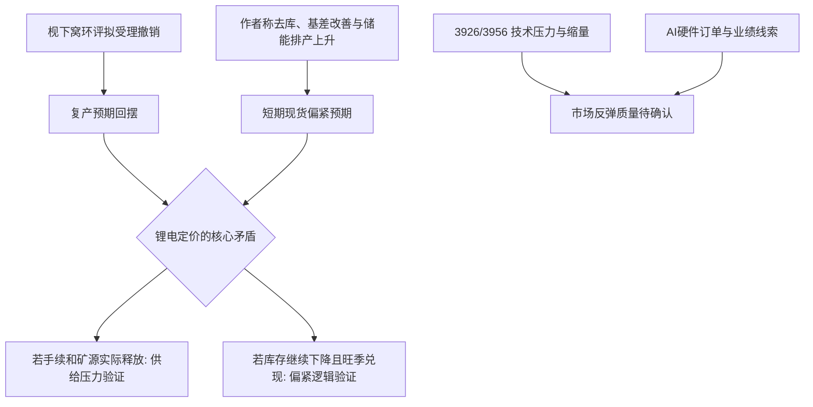

# 📊 每日投资简报 — 2026年8月27日（星期四·盘前）

> **数据来源**：雪球（42篇）、微博（16篇）、微信公众号（5篇） | 共 **63 篇**文章
> **覆盖时段**：2026-08-26 08:00 ~ 2026-08-27 08:00（北京时间）
> **覆盖作者**：雪球 12/21 位 | 微博 4/4 位 | 微信 5/5 个
> **生成时间**：2026年8月27日 盘前

---

## 今日三句话

| 项目 | 内容 |
|---|---|
| 今日最重要变化 | 锂矿枧下窝环评拟受理公示被撤销，供给复产预期再起波折；同时，wu2198 记录盘中两市成交 18030 亿元、资金净流入 166.86 亿元，局部风险偏好有所修复。 |
| 对投资假设的影响 | 作者对锂电的分歧从“是否有远期新增供给”转向“短期现货和去库是否足以压过复产预期”；待验证条件是枧下窝手续、实际供给释放和旺季库存数据。 |
| 今日不做什么 | 不把技术反抽或单份业绩直接外推为普涨行情：wu2198 提醒 3926 一带仍有多空争夺，唐史主任司马迁建议缩量时缩圈交易、等待右侧确定性。 |

## 零、✅ 上期观察点验证

本期 `evidence-tasks.json` 未列出到期或计划复查假设，结构化 `verification.json` 的结果为空；因此今日无可复核的上期观察点验证结果。

## 一、💼 博主持仓信息

| 博主 | 持仓/操作 | 原文摘要 |
|---|---|---|
| 陈达美股投资（雪球） | 明确长期持有赤子城科技（09911） | “赤子城 topline bottom line双 beat。这股我要拿十年。” |
| 三岁小怪兽（微信公众号） | 对立讯精密的计划性回补已错过，非当前持仓披露 | “上次跳空击穿年线卖的、计划是站上年线再买回的。此刻，已经在后悔，昨天2选1错了。” |
| 九洲仙人（雪球） | 高位科技股放量大跌时减仓 | “在高位科技股必然不可能长期持有。放量大跌正常都要减仓。” |
| 诸葛孔暗（雪球） | 保持仓位，等待低吸 | “保持仓位，等待低吸。” |

## 二、📡 博主看好方向汇总

| 博主 | 看好方向 | 看空/回避方向 | 操作建议摘要 |
|---|---|---|---|
| 柯中投研笔记 | 锂电、储能、有色铜、8月底至9月的市场 | 无明确回避方向 | 认为调整若延续最多再完成 1–2 天，之后“整体看多做多为主”。 |
| 热点投研 | 碳酸锂供需错配逻辑 | 把锂矿远期复产当作短期实际供给 | 关注环评、矿权和海外扩产的实际推进，而非情绪化复产传闻。 |
| 三岁小怪兽 | 半导体设备、AI 硬件、立讯精密 | 锂电的“负贝塔”竞争格局；理想汽车反转预期 | 重视行业贝塔与订单重估，称半导体设备受国产化招标预期驱动。 |
| wu2198 | 固态电池材料、业绩增长公司、有色铜 | 未明确回避方向 | 固态电池应等产品推出或量产；技术上观察 3926/3956 区间。 |
| 陆家嘴幽灵 | AI 硬件、英伟达供应链 | 对自研芯片叙事的简单外推 | 以 OpenAI 自研推理芯片性能、成本和供应链影响为观察对象。 |
| 陈达美股投资 | 赤子城科技、AI 驱动全球化社交 | 未明确回避方向 | 看重收入与利润双增长、产品出海复制和 AI 投放效率。 |
| 买股票的老木匠 | 周期低位的价格差与安全边际 | 高位周期龙头、低迷期未充分出清的标的 | 更偏好具备价格弹性的中游公司。 |
| 九洲仙人 | 红利方向（相对偏好） | 高位科技股、业绩发布后的追买 | 强调高位科技的减仓纪律，不以业绩公布作为追入依据。 |
| 睿知睿见 | 未明确新增看好方向 | 白酒盈利下行风险 | 白酒若投资先按“沦为红利股”的更差情形评估。 |
| 唐史主任司马迁 | 基本面票的右侧机会 | 缩量环境下追求全面确定性 | 缩量时缩圈做；不交易则等基本面票回到网格。 |
| Value_at_Risk | 年末可能出现更重要行情 | 当前即为主升阶段的判断 | 提醒关注有效税率上升对盈利的影响。 |
| 冰冰小美 | 有色金属与流动性宽松相关线索 | 仅依据期货走势交易个股 | 将比特币/稳定币作为全球金融资产观察视角，明确非买卖推荐。 |

## 三、⚡ 今日注意事项与投资总结

| 维度 | 作者观点归纳 | 来源 |
|---|---|---|
| 市场情绪 | 盘中资金流入但热点仍局部化，量能与关键点位争夺决定反弹质量。 | wu2198、诸葛孔暗 |
| 重点事件 | 枧下窝环评拟受理撤销，使锂矿复产预期再度摇摆；这是供给节奏事件，不等同于当下现货增加。 | 热点投研、柯中投研笔记 |
| 风险提示 | 高位科技若放量下跌，九洲仙人主张减仓；固态电池尚需等待产品与量产，不能仅靠主题预期。 | 九洲仙人、wu2198 |
| 板块机会线索 | 锂电/储能的去库与出口数据、有色铜的趋势与低估值、半导体设备的国产化订单预期、AI 硬件业绩兑现。 | 柯中投研笔记、三岁小怪兽 |
| 作者操作共识 | 不把单日反抽视为全面行情；围绕可验证的业绩、库存和实际项目进展，缩量时控制交易半径。 | wu2198、唐史主任司马迁、陆家嘴幽灵 |

---

## 四、枧下窝环评撤销：锂电的“现实去库”与“远期供给”再度拉扯

宜春市生态环境局撤销枧下窝锂矿项目环评报告书拟受理公示，是今日材料最集中的供给侧事件。热点投研认为，市场此前对 9 月复产的乐观预期难以直接兑现，短期不会释放实际矿源；柯中投研笔记则把讨论落在库存、基差与旺季排产，认为当前去库与需求强度仍更关键。两者结论方向相近，但都属于作者或机构转述，尚待官方手续和后续数据验证。

> **热点投研（微信公众号）**：“市场对锂矿供给的预期过于乐观，而实际增量释放节奏远低于预期。需求端在高油价和储能需求驱动下仍保持高增长，供需错配将支撑锂价中枢。”

> **柯中投研笔记（微信公众号）**：“现在才8月份，才刚进入旺季，真正这个行业的旺季是在10，11月份的。”

| 观点碰撞 | 结论 | 论据与待验证点 |
|---|---|---|
| 🟢 热点投研 | 复产预期难以形成短期实际供给，供需错配偏多。 | 环评撤销、国内审批慢、海外扩产释放远；待验证手续恢复和真实产量。 |
| 🟢 柯中投研笔记 | 去库、基差与 9 月排产支持锂价逻辑。 | 作者称本周去库 6450 吨、9 月新增排产约 30GWh；这些为作者数据，待第三方库存/现货数据确认。 |
| 🟡 wu2198 | 固态电池可关注，但量产才是契机。 | 对电池主题保持条件式参与，反证是产品和量产推进继续落空。 |
| 🔴 三岁小怪兽 | 锂电行业处于“负贝塔”竞争环境。 | 上游、下游围绕利润分配博弈，认为个股 alpha 获利困难。 |

## 五、AI 硬件与半导体：业绩、国产化与自研芯片叙事同时升温

三岁小怪兽将半导体设备的强势归因于国产化下的订单和收入重估，并从立讯精密交流会中提炼出光模块、超节点、液冷和电源的 2027 年利润预期。陆家嘴幽灵则围绕 OpenAI 自研推理芯片提出更细的观察框架，材料没有提供可独立核验的官方芯片文件，以下均为作者解读而非已验证事实。

> **三岁小怪兽（微信公众号）**：“美帝限制升级 → 晶圆厂必须国产化 → 设备招标量井喷 → 整个板块的未来订单和收入要重估。”

> **陆家嘴幽灵（雪球）**：“昨晚美股科技回暖，英伟达结束七连跌收涨超2%。”

| 线索 | 作者观点 | 关键数字/观察点 |
|---|---|---|
| 半导体设备 | 行业贝塔优先于单家公司静态估值，国产化招标可能重估订单。 | 北方华创业绩被市场重新定价，后续看实际招标与订单。 |
| 立讯精密 AI 业务 | 作者转述其 2027 年光、铜、液冷、电源利润可能爆发。 | 当前 3 条产线，计划 2027 年 6 月前增至 10 条；为公司交流会信息转述。 |
| 存储与 AI 供应链 | 淡淡的相思林关注 HBM4 份额和 NAND 扩张目标。 | 其对产能目标提出质疑，提醒勿把远期产能写成近年业绩。 |
| 自研芯片 | OpenAI/博通路线可能影响加速器供应链定价。 | 看性能、功耗、成本和量产节奏，不能仅以单次测试替代商业化判断。 |

## 六、指数反抽并未消除缩量约束：3926 是短线观察点，不是结论

wu2198 把上证从 3994 至 3850 后反抽 3926 的走势界定为技术修正，认为 3926/3956 的压力区仍有反复；盘中数据则显示两市成交到 14:56 为 18030 亿元、2932 只个股上涨、大盘资金流入 166.86 亿元。唐史主任司马迁和九洲仙人的纪律更保守，前者主张缩量时缩圈做，后者提醒高位科技的放量下跌要减仓。

> **wu2198（微博）**：“接下来的技术反压是3926/3956这30点区域了，多空有反复是必然结果。”

> **唐史主任司马迁（微博）**：“缩量的交易缩圈做，不做交易就等基本面票跌到网格，想等确定性，那就再等等右侧。”

| 情景 | 多头依据 | 约束/风险 |
|---|---|---|
| 🟡 短线修复 | 盘中资金净流入、上涨家数占优，柯中投研笔记认为调整后更偏多。 | 热点暂未形成明显板块效应，成交较上一交易日同期下降 235 亿元。 |
| 🔴 高位科技 | AI 硬件、半导体存在业绩与订单线索。 | 九洲仙人认为高位科技难长期持有，放量下跌应减仓。 |
| 🟡 周期与红利 | 铜业绩、低估值和周期出清被多位作者提及。 | 买股票的老木匠强调低位也要看股东出清和价差，不能把龙头天然等同于安全边际。 |

## 七、业绩披露把选股重新拉回利润表：有色、出海社交与消费分化

当日业绩材料覆盖有色、电子材料、全球化社交和白酒。wu2198 转述江西铜业上半年归母净利润 86.32 亿元、同比增长 106.77%；陈达美股投资则分析赤子城科技收入 6.07 亿美元、同比增长 37.0%，归母净利润 0.99 亿美元、同比增长 45.8%，并强调其全球化社交与 AI 投放效率。相对地，睿知睿见将白酒中报描述为比惨，并要求先承受更差情景。

> **陈达美股投资（雪球）**：“整体投资逻辑就是在从区域玩家生长为一家全球化公司。”

> **睿知睿见（雪球）**：“如果要投资，就要先考虑最坏的情况，那就是它沦为红利股。”

| 方向/标的 | 文章披露或作者解读 | 风险边界 |
|---|---|---|
| 江西铜业 | wu2198 转述营收同比 +19.53%、归母净利同比 +106.77%。 | 单期业绩及冲板表现不替代铜价、成本与估值持续性验证。 |
| 赤子城科技（09911） | 陈达美股投资称季度收入、毛利和归母净利均增长，并持有十年。 | 经调整利润增速低于收入增速；其文中亦指出销售投入和新市场拓展压低 EBITDA 利润率。 |
| 白酒 | 睿知睿见认为中报承压，应以更差情景评估。 | 没有作者给出明确反转催化或持仓操作。 |
| 周期股 | 买股票的老木匠强调低价差与股东出清。 | 高质量龙头若低迷期跌幅不足，反弹空间未必具吸引力。 |

## 八、📋 数据覆盖情况

| 来源 | 已覆盖作者 | 缺失作者 | 覆盖率 |
|---|---|---|---|
| 雪球 | 九洲仙人、买股票的老木匠、冰冰小美、大橘养基桶、我不会选股2019、润哥、淡淡的相思林、睿知睿见、诸葛孔暗、门捷列夫学徒、陆家嘴幽灵、陈达美股投资 | DAVID自由之路、古董鱼、suoluos、柯中、管我财、泡沫艺术家、行中衡、躺红利摊转债、小豆小瓜_ | 57.1%（12/21） |
| 微博 | Value_at_Risk、wu2198、唐史主任司马迁、谢佩德骨头 | 无 | 100%（4/4） |
| 微信公众号 | ETF领航员、三岁小怪兽、柯中投研笔记、热点投研、猫笔刀 | 无 | 100%（5/5） |

## 九、🎯 核心矛盾梳理

图中供给、库存、排产及技术点位分别来自作者文章与盘中记录，未经过本期独立数据验证。对市场而言，锂电是“远期供给预期能否压过当下去库”，指数则是“局部业绩线索能否扩散为量价配合”。

## 十、🔭 下期关注（待验证假设）

本期未新增假设。原因是当前锂电、AI 硬件与市场节奏的判断均依赖后续库存、手续、订单或量能数据，尚不足以形成不重复且高价值的可证伪条目；`hypotheses.json` 已按此记录为空集合。

## 十一、💎 今日精选标的

### 最值得关注的个股/ETF

| 标的代码 | 标的名称 | 推荐理由（来源作者） | 风险提示 |
|---|---|---|---|
|  | 今日无多位作者共同看好的标的 | 当日材料未出现至少 2 位不同作者对同一标的的明确看好。 | 不以单一作者的业绩解读或交易计划替代交叉共识。 |

### 今日最强共识方向

今日作者观点较为分散，未形成至少 3 位作者共同明确看好的单一方向。锂电/储能获得柯中投研笔记、热点投研与 wu2198 的讨论，但三者对可交易时点、供给约束与量产条件的侧重不同，故仅列为重点观察，不定义为强共识。

### 编辑说明

本板块基于当日所有作者观点的交叉分析，提取共识度最高的标的和方向。**这不是投资建议**，仅作为信息汇总参考。标的选择应：

- 结合个人风险承受能力
- 关注原文中的风险提示
- 验证支持逻辑是否仍然成立

---

> **免责声明**：本简报为原始数据的结构化整理，所列观点均来自原作者，不代表任何投资建议。市场有风险，投资需谨慎。
>
> *2026年8月27日 · 数据来源：雪球 / 微博 / 微信公众号*
