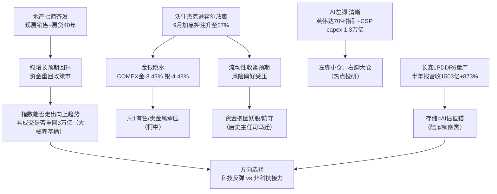

# 📊 每日投资简报 — 2026年8月31日（周一·盘前）

> **数据来源**：雪球（20篇）、微博（14篇）、微信公众号（4篇） | 共 **38 篇**文章
> **覆盖时段**：2026-08-30 08:00 ~ 2026-08-31 08:00（北京时间）
> **覆盖作者**：雪球 14/21 位 | 微博 4/4 位 | 微信 4/5 个
> **生成时间**：2026年8月31日 盘前

---

## 今日三句话

| 项目 | 内容 |
|---|---|
| 今日最重要变化 | 沃什杰克逊霍尔放鹰，9月加息押注升至57%，COMEX金银周五跳水（金-3.43%、银-4.48%）；周末地产“七箭齐发”新政落地，现房销售+房贷延至40年。 |
| 对投资假设的影响 | 流动性收紧预期升温，压制贵金属与风险偏好，地产新政托底稳增长预期；待验证：9月非农/CPI落地、日本央行加息后市场反应。 |
| 今日不做什么 | 不追高地产（柯中）、不救图形未走好的胜宏（三岁小怪兽）、不做无预期差无业绩的方向（柯中）、不为短期波动割掉有色长线仓（诸葛孔暗）。 |

## 一、💼 博主持仓信息

| 博主 | 持仓/操作 | 原文摘要 |
|---|---|---|
| 诸葛孔暗（雪球） | 5-6成仓，重仓有色 | “我为什么抗有色？……4-6月最恐慌的时刻加息概率90%……弱势的有色反弹也有40-50%，强势的翻倍一批” |
| 我不会选股2019（雪球） | 已换成长江电力 | “自己已经换成了长江电力” |
| 门捷列夫学徒（雪球） | 8月买入光方向、押对PTFE路线 | “我因为8月买到了光里面锐度较强的方向和押对了ptfe这个路线……比较拖后腿的是存储” |
| 三岁小怪兽（微信） | 观察胜宏科技，暂不买入 | “暂时还是认为胜宏是低估值、高成长的重要标的，但图形没有走好之前，不打算去救刚子了” |
| Value_at_Risk（微博） | 环球医疗以收息心态持有 | “抱着收息的心态是最好的，股息率低于5%了就卖点，高于8%了就买点” |
| Value_at_Risk（微博） | 浙江鼎力可作配置 | “这个估值和业绩来说，安全边际还是足够的，保守的人是可以拿来做配置的” |

> 注：持仓信息只来自作者明确披露；未明确披露持仓的作者不列。

## 二、📡 博主看好方向汇总

| 博主 | 看好方向 | 看空/回避方向 | 操作建议摘要 |
|---|---|---|---|
| 九洲仙人（雪球） | 白电（首选）、区域城商行（江苏/宁波/齐鲁） | 煤炭（末选，追高风险最大） | 推荐顺序：白电 > 银行 > 煤炭 |
| 诸葛孔暗（雪球） | 有色/白银（白银>黄金） | 加息若落地则清仓 | 5-6成仓逢低加仓，“越跌越没有卖的动作” |
| 大橘养基桶（雪球） | 贵金属（黄金坑）、军工、地产新政利好指数 | 地产板块本身（温和刺激） | “下周是Q4前最好的加仓时点” |
| 柯中（微信） | 铜（格局更好）、储能（预期差）、农业（厄尔尼诺）、锂电池 | 周一有色承压、地产追高 | 多看上证/沪深300，把握上证月线死叉后的节奏 |
| 热点投研（微信） | AI硬件/算力（左脚I）小仓 | 右脚R（模型智能/应用）未清晰 | “左脚小仓、右脚大仓” |
| 淡淡的相思林（雪球） | 存储/AI硬件（产业逻辑强） | 当下无趋势投资机会 | “控制仓位，等待市场给出方向” |
| 陆家嘴幽灵（雪球） | 长鑫/国产存储、端侧AI | — | 长鑫LPDDR6量产是DRAM定价锚 |
| 唐史主任司马迁（微博） | 半导体/长鑫链、HBM、确定性方向的小分支 | 高位无边际变化的方向 | “在大方向有确定性的地方找有边际变化有增量的小分支” |
| 躺红利摊转债（雪球） | 低波红利指数 | 中证红利（评级下调至B+） | 配置红利资金可多考虑低波类 |
| 小豆小瓜_（雪球） | 科技长线（机构压舱石未撤） | 科技短线调整概率大 | 无新应用场景则科技叙事见顶 |
| 我不会选股2019（雪球） | 长江电力 | 中国石油（回撤风险更大） | 已换仓 |
| 冰冰小美（雪球） | 能源/农产品（通胀对冲） | 美债/利率上行 | 警惕债务死亡螺旋、1977年重演 |
| 买股票的老木匠（雪球） | 未明确 | 警惕美联储加息、警惕共识 | 反向思维、独立思考 |
| 睿知睿见（雪球） | 未明确（等待） | 折腾/短线 | “在该折腾的时候折腾，不该折腾的时候等待” |
| 行中衡（雪球） | 未明确表态 | — | 股市比生活竞争更激烈 |
| 陈达美股投资（雪球） | 未明确表态 | — | — |
| Value_at_Risk（微博） | AI需跑通商业模式 | 高估值标的（影石、B站、移为通信） | 中国消费者不愿为软件付费 |
| wu2198（微博） | 未明确 | 金饰消费（销量暴跌34%） | — |
| 谢佩德骨头（微博） | 未明确（市场感悟） | — | 二级市场用仓位和收益率表达对错 |
| 门捷列夫学徒（雪球） | 紧跟产业（CPO/NPO/PTFE/液冷） | 9月不进攻 | 真正timing在11-12月 |
| 三岁小怪兽（微信） | 地产（温和利好）、低估值高成长 | 机构本周主流策略是防守 | “八月留给大家回本的时间只有一天” |

## 三、⚡ 今日注意事项与投资总结

- **市场情绪**（盘前）：周末地产新政发酵与沃什鹰派利空交织。成交约2万亿但量化规模扩大、“活人感差”，活跃资金多数在休息（唐史主任司马迁·微博）；“周末情绪比前两周都要平淡，雪球发帖量同比-4%，机构研报数据同比-15%，股票群平均消息数不足20条”（小豆小瓜_·雪球）。
- **重点事件**：① 沃什杰克逊霍尔讲话，9月加息押注升至57%（冰冰小美、小豆小瓜_）；② 地产“七箭齐发”新政（大橘养基桶、小豆小瓜_）；③ 长鑫LPDDR6量产、小米18 Fold全球首发搭载（陆家嘴幽灵、淡淡的相思林）；④ 8月31日上证收月线，月线MACD死叉（柯中）。
- **风险提示**：贵金属因加息预期跳水，周1有色方向承压（柯中）；地产高开震荡不好追（柯中）；科技短线调整概率大（小豆小瓜_）；9月末日本央行加息概率极大，对大宗不利，重仓有色需做回避计划（诸葛孔暗）。
- **板块机会线索**：贵金属黄金坑加仓（大橘养基桶）；有色长线趋势、白银投机盘空间更大（诸葛孔暗）；军工阶段性机会（大橘养基桶）；储能预期差（柯中）；国产存储/半导体（唐史主任司马迁、陆家嘴幽灵）；低波红利（躺红利摊转债）。
- **作者操作共识**：防守为主（三岁小怪兽·微信“机构本周主流策略都是防守了”）；逢低分批加仓（诸葛孔暗·雪球）；控制仓位等方向（淡淡的相思林·雪球）；产业左脚（硬件）下小仓、右脚（应用）下大仓（热点投研·微信）。

> 以上为当日作者观点归纳，非编辑个人建议。

---

## 四、沃什放鹰与加息预期：金银跳水，博弈期拉长

本周最核心变量是美联储主席沃什在杰克逊霍尔年会上的鹰派讲话。市场对9月加息概率的定价出现剧烈反转，但各作者对“会不会真的加息”分歧明显。

> “这次沃什show非常的偏鹰，市场直接将9月份加息概率调整过来了，目前最新的情况是加息的概率略多一点点，而不加息的概率略小一点。1年期美债已经到了4%+，而2年期美债也到了4.3%的位置……个人还是认为不加息的概率略大一点。不过因为这个的变化，黄金白银周5晚上大跌，这样的话，周1有色方向是要有所承压了。”（柯中·微信）

> “沃什在杰克逊霍尔明确表示，广义金融条件很难被称为‘限制性’→即利率还不够高。他倾向于让市场力量决定长端利率……25次提及通胀，却对美债市场的长端收益率飙升只字不提。市场将此解读为美联储明确拒绝为财政部的干预背书。会后10年期美债收益率反而再涨5个基点，9月加息的押注概率从43.5%升至57%。”（冰冰小美·雪球）

> “他讲完话后，9月加息25BP的概率从30%飙升到57.5%，周五晚上美股大幅跳水，AI板块是下跌重灾区。加息利空黄金，周五黄金也跌了-3%。”（小豆小瓜_·雪球）

立场最坚决的反方是诸葛孔暗和买股票的老木匠，他们认为市场对加息过度恐惧：

> “美联储是不可能9月加息的，这是定论，永远记住一个超级经济体它的核心经济不是只为了股市服务的……如果加息真的极小概率真的落地了，果断清仓就好了。”（诸葛孔暗·雪球）

> “这个市场是一个输家占多数的博弈模式，并且大部分的赢家都不会在自媒体上发表自己的观点……当他们都认为有色不可替代时，当他们都认为券商是公认的渣男时，当他们认为大盘会永远处在3000点以下时，我也感受到了几乎相同的情绪，相同的谩骂，相同的人身攻击。”（买股票的老木匠·雪球）

冰冰小美则把加息争议放进更长的财政-利率框架，警示债务死亡螺旋与1977年历史重演：

> “债务死亡螺旋最为警惕（瑞达利欧预警）。即，财政赤字扩大→发更多债→债券价格下跌，收益率上升→利息支出增加→赤字更大……结论很清晰，美债利率上行也是结构性困境。”（冰冰小美·雪球·8月月报一）

**作者观点分层**：🔴 市场定价加息概率升至57%（冰冰小美、小豆小瓜_、柯中）｜🟡 诸葛孔暗、买股票的老木匠认为9月加息近乎不可能，是情绪放大｜🟢 柯中判断“不加息概率略大”，但周一有色、贵金属短期承压是共识。

## 五、地产“七箭齐发”：从防风险到促发展

周末地产新政被普遍视为本期国内最重要事件。核心是“2个顶层制度+5个信贷办法”，涉及现房销售、预售收紧、房贷期限30年延至40年、支持房企并购重组与再融资、放开房地产信托融资。

> “周末国内最大的新闻，肯定就是地产的‘七箭齐发’了，或者说2个顶层制度+5个信贷办法……总体定调应该是温和刺激而非强刺激，而且集中在供给端，需求端的配套政策预计还会跟着出来，比如进一步降低存量房贷的压力，降息降准或许在路上。”（大橘养基桶·雪球）

> “对地产股影响最大的是：支持上市房企并购重组和再融资。这意味对地产的态度出现了巨大的转变……态度从防风险到促发展，地产行业很可能会有新的重整机会。”（小豆小瓜_·雪球）

> “大力推进现房销售，预售全面收紧；个人住房贷款期限从最长30年延长到最长40年……利好，不是特别大。但要感受到，领导想稳住地产、提振内需的坚定决心，会不断的从工具箱掏家伙。”（三岁小怪兽·微信）

围绕地产板块本身与对指数的意义，作者之间有微妙分歧：

| 作者 | 对地产新政的结论 |
|---|---|
| 大橘养基桶（雪球） | 温和刺激、非强刺激；对市场的意义是让资金重新相信稳经济，指数有望重新走出向上趋势 |
| 小豆小瓜_（雪球） | 态度从防风险转向促发展，行业有重整机会；一线城市好地段次新房/新房中短期或涨价 |
| 柯中（微信） | “逻辑上应该也是一个高开后高位震荡为主，肯定是不好追的”；明年初有总结性文件落地 |
| 三岁小怪兽（微信） | 利好“不是特别大”，但显示政策工具储备充足 |
| 唐史主任司马迁（微博） | 地产股票“不做评价，更多看筹码”；从消费者角度建议存量延按揭、等现房 |

> “地产股票不做评价，更多看筹码。但从消费者的角度，建议两个事情，存量的去延长按揭时间，大概率后面的利息越来越低……没有买想买的，等现房出来货比三家（到时候利息也更低）。”（唐史主任司马迁·微博）

## 六、AI资本开支与存储：英伟达70%指引、长鑫LPDDR6量产

AI 是本期唯一被最多作者提及、但分歧也最大的主线。英伟达首次给出下一财年约70%的营收指引，叠加长鑫LPDDR6量产，硬件叙事重新被点燃。

> “尽管英伟达给出了史上首次的下一财年指引，增长高达70%……意味着明年营收将达到7000亿美元的水平，如果供应链（存储、晶圆）产能限制解除，营收将有望达到100%的增长。”（淡淡的相思林·雪球）

> “nv FY2028 约 70% 的增长展望。这比当季业绩更重要，因为它直接上修了市场对明年硬件需求和供给兑现的预期……nv电话会明确：五大 CSP 2027 年 1.3 万亿美元资本开支预期……产业的左右脚不断有正面信号出现就加仓，负面信号就减仓，左脚小仓、右脚大仓。”（热点投研·微信）

存储是本轮资本开支逻辑里最尖锐的环节。长鑫（CXMT）上市后首份半年报与LPDDR6全球首发量产成为多头锚：

> “CXMT周五发布上市以来的首份半年报……2026年上半年，该公司实现营业收入1503.1亿元，同比增长873.64%；归属于上市公司股东的净利润776.05亿元，同比扭亏为盈……LPDDR6峰值速率达12800Mbps，芯片最高容量16GB。目前该产品已向关键客户送样验证，正加速推进量产。”（淡淡的相思林·雪球）

> “长鑫此次交出的LPDDR6答卷，在技术指标上达到国际第一梯队水准……从亦步亦趋的区域替代者向全球技术标准领跑者身份转换，标志着国产存储在先进制程的研发体系和良率控制上，已经具备了相当的体系化能力……长鑫实际上构成了全球DRAM主流产品的一道价格锚。”（陆家嘴幽灵·雪球）

> “长鑫出的业绩还是不错的，周边一些半导体公司出的业绩也可以相互验证。所以整个方向更多还是贵的问题等调整下来……和小米合作商用lpddr6，实际上证明了跨代研发的进度超出市场预期，由此可以推测，hbm3、3e的进度也可能超预期。”（唐史主任司马迁·微博）

但短线情绪并不一致。小豆小瓜_用舆情指标提示科技短线调整概率大：

> “上上周，散户在科技上的净情感是15%，现在下降到11.5%；机构从+90%回升到+92%；自媒体从+35%下滑到+8%……科技股短线调整概率很大，但长线暂时还没有崩盘风险，因为大资金信心还在。”（小豆小瓜_·雪球）

**作者观点分层**：🟢 长鑫LPDDR6量产、英伟达70%指引、CSP capex上调是产业左侧的硬信号（淡淡的相思林、陆家嘴幽灵、热点投研、唐史主任司马迁）｜🟡 但“当下硬件确实没啥趋势投资，只能看看”（淡淡的相思林）、“9月不是交易进攻的好时候，真正timing可能在11-12月”（门捷列夫学徒）｜🔴 短线调整概率大、叙事若无新场景则科技见顶（小豆小瓜_）。

## 七、半年报密集点评：Value_at_Risk 八连评

微博作者 Value_at_Risk 对多只 A/H 股半年报做了密集点评，覆盖和铂医药、哔哩哔哩、影石创新、浙江鼎力、环球医疗、移为通信、裕同科技、视源股份。其点评以“业绩是否符合预期 + 估值是否合理”为主线，整体偏谨慎：

| 标的 | 半年报要点 | 作者结论 |
|---|---|---|
| 影石创新 SH688775 | 2026H1收入55.2亿(+50.3%)，归母净利0.3亿(-94.1%)；Q2单季亏损 | “暂时看不到拐点……目前480亿市值还是贵了” |
| 哔哩哔哩 HK09626 | 2026Q2营收79.4亿(+8%)，经调整净利7.04亿(+25%) | 32倍PE“相较于可比公司平均15倍左右，没太大的优势” |
| 环球医疗 HK02666 | 2026H1收入71亿(-6.3%)，归母净利12.63亿(+2.8%)，PE 3.7、股息率约8% | “最好别指望估值修复……抱着收息的心态是最好的” |
| 浙江鼎力 SH603338 | 2026H1营收54.1亿(+24.9%)，剔除汇兑后净利增速超40% | “安全边际还是足够的，保守的人是可以拿来做配置的” |
| 移为通信 SZ300590 | 2026H1营收6.04亿(+67.7%)，归母净利0.88亿(+184%) | 40倍PE偏高，“继续关注其拐点的持续性” |
| 视源股份 SZ002841 | 2026H1收入143.9亿(+36.2%)，归母净利15.2亿(+282%) | 高增长不可持续，“下半年利润增长就会开始下滑” |
| 裕同科技 SZ002831 | 2026H1营收82.14亿(+4.3%)，扣非净利微降 | 21倍PE“比较鸡肋”，看N+T新业务 |
| 和铂医药-B HK02142 | 2026H1收入1.22亿美元(+20.9%)，净利6485万美元 | 技术平台授权+BD模式，下半年多项临床数据读出 |

> “本质上，AI要找到愿意为其买单的消费者或者跑的通的商业模式才是最重要的，不然即便能不断地拉低低成本也只会为她人做嫁衣。”（Value_at_Risk·微博）

## 八、有色与贵金属：黄金坑 vs 短期承压

贵金属是本期限分歧最大的交易主题。加息预期压顶 vs 美债信用质疑带来的避险逻辑，让作者站在不同侧。

> “周五会议之后，金银极速跳水，COMEX黄金跌3.43%，COMEX白银跌4.48%。我们认为，这是市场给予的一次难得的黄金坑加仓机会……现在还能拯救美债的可能真的只剩下那一招了，那就是重估诺克斯堡黄金价值，反过来，利好黄金。下周或许就是一次难得的贵金属加仓时机，尤其是能在当前位置再往下到4400美元左右。”（大橘养基桶·雪球）

> “如果加息真的极小概率真的落地了……有色里白银比黄金弱，后面黄金空间要么再跌出来一次，还能搞，要么comex黄金在4500坚挺，白银的投机盘属性空间更大一些。”（诸葛孔暗·雪球）

> “可能没有这个演讲，铜和黄金下周都有概率继续向上一个台阶的，不过现在又要回到博弈节奏。不过相对来说，铜目前的格局还是会更好一点。”（柯中·微信）

**作者观点分层**：🟢 大橘养基桶把金银跳水视为加仓机会（黄金坑），诸葛孔暗长线看多有色、白银弹性更大｜🟡 柯中认为短期有色承压、但铜格局更好｜🔴 冰冰小美把利率上行视为结构性困境，能源/农产品是通胀对冲方向。

## 九、市场情绪与资金面：量化主导下的“垃圾时间”

多位作者从不同侧面描绘当前市场：成交尚可但“活人感”不足，量化放大波动、风格快速切换，趋势难以形成。

> “市场相对来说还是比较弱，两万亿上下的成交看起来还可以，但剔除当下越来越大的量化规模，活人感还是比较差的……有些没离场的资金就抱团搞妖股，炒大米炒重组等等，其实不大看产业逻辑，更多还是在小盘和监管规则博弈。”（唐史主任司马迁·微博）

> “风格快速来回转，但就是没有趋势形成。量化快速的进出，使得频繁操作总是被摆一刀……我们的收益主要集中在20%的时间里达成，甚至10%的时间里达成。”（睿知睿见·雪球）

> “市场这里整体是看一个向上的周期为主……上证指数明天收月线，第一次这么久以来月线级别macd死叉，肯定不是什么好事……单纯从周线来说，这里不管是否涨回来，不管是否新高，基本都会出现顶背离。”（柯中·微信）

门捷列夫学徒从流动性第一性原理出发，认为当前核心矛盾是宏观流动性，而非产业：

> “当前资本市场的核心矛盾就是宏观流动性，反而是产业上就那些东西已经不是主要焦点……加不加息其实已经不重要了，但资本市场担心的不是加息的现实而是加息的预期……9月，我认为也不是交易进攻的一个好时候，真正的timing可能在11-12月年底。”（门捷列夫学徒·雪球）

**今日不做什么的共识出处**：柯中（微信）地产“肯定是不好追的”、不做“没有预期差且又没有业绩”的方向；三岁小怪兽（微信）不救图形未走好的胜宏、“机构本周主流策略都是防守了”；诸葛孔暗（雪球）不为跌得过多纠结、不因情绪在3850下方割肉。

---

## 十、📋 数据覆盖情况

| 来源 | 已覆盖作者 | 缺失作者 | 覆盖率 |
|---|---|---|---|
| 雪球 | 14位：九洲仙人、买股票的老木匠、冰冰小美、大橘养基桶、小豆小瓜_、我不会选股2019、淡淡的相思林、睿知睿见、行中衡、诸葛孔暗、躺红利摊转债、门捷列夫学徒、陆家嘴幽灵、陈达美股投资 | 7位：DAVID自由之路、古董鱼、suoluos、柯中、管我财、泡沫艺术家、润哥 | 14/21 ≈ 66.7% |
| 微信公众号 | 4个：三岁小怪兽、柯中投研笔记、热点投研、猫笔刀 | 1个：ETF领航员 | 4/5 = 80% |
| 微博 | 4位：Value_at_Risk、wu2198、唐史主任司马迁、谢佩德骨头 | 无 | 4/4 = 100% |

> 注：覆盖率按 `expected_authors` 配置计算；猫笔刀当期文章无可提取正文，仍计入覆盖数。

## 十一、🎯 核心矛盾梳理

| 矛盾 | 多方 | 空方/谨慎方 | 关键变量 |
|---|---|---|---|
| 美联储加息 | 冰冰小美、小豆小瓜_（市场定价57%） | 诸葛孔暗、买股票的老木匠、柯中（不加息概率大） | 9月非农/CPI、2年期美债、日央行加息 |
| AI行情 | 热点投研、淡淡的相思林、陆家嘴幽灵（产业左侧硬信号） | 小豆小瓜_（短线调整概率大）、门捷列夫学徒（9月不进攻） | 新应用场景、ARR、模型智能是否带来R |
| 贵金属 | 大橘养基桶（黄金坑）、诸葛孔暗（有色长线） | 柯中（周1有色承压）、冰冰小美（利率上行结构压力） | 美债信用、诺克斯堡重估、加息落地 |
| 地产 | 小豆小瓜_（防风险转促发展） | 柯中（高开震荡不好追）、大橘养基桶（温和刺激非强刺激） | 成交量能、存量房贷、需求端配套 |

## 十二、🔭 下期关注（待验证假设）

本期用户选择跳过假设跟踪验证，未新增假设；系统判定 5 条活跃历史假设均未到复查日。

## 十三、💎 今日精选标的

基于当日所有作者观点的交叉分析，汇总共识度最高的标的和方向。

### 最值得关注的个股/ETF

| 标的代码 | 标的名称 | 推荐理由（来源作者） | 风险提示 |
|---|---|---|---|
| SH688825 | 长鑫科技 | LPDDR6全球首发量产、小米18 Fold搭载，构成DRAM定价锚（陆家嘴幽灵）；半年报营收+873%、跨代研发超预期（淡淡的相思林、唐史主任司马迁） | 唐史主任司马迁提示“整个方向更多还是贵的问题，等调整下来”；产能爬坡与HBM进度不确定 |
| SH518880 | 黄金ETF华安 | 金银跳水视为黄金坑加仓机会（大橘养基桶）；黄金长线空间、白银投机盘弹性（诸葛孔暗） | 若加息落地金银继续承压（柯中）；诸葛孔暗提示白银弱于黄金 |

**提取说明**：长鑫科技被陆家嘴幽灵、淡淡的相思林、唐史主任司马迁三位作者交叉看好；贵金属被大橘养基桶、诸葛孔暗两位作者看好。其余标的均不足两位作者明确看好，未列入。

### 今日最强共识方向

- **方向1：AI算力硬件与存储**（5位作者提及：热点投研、淡淡的相思林、陆家嘴幽灵、唐史主任司马迁、门捷列夫学徒）——产业左侧信号集中（英伟达70%指引、CSP capex、长鑫量产），但存在“短线调整概率大”（小豆小瓜_）与“9月不进攻、timing在年底”（门捷列夫学徒）的分歧，属高分歧主题。
- **方向2：有色金属/贵金属**（4位作者提及：诸葛孔暗、柯中、大橘养基桶、冰冰小美）——短期限加息压制与中长期避险/通胀逻辑并存，方向上“白银弱于黄金但投机弹性更大”（诸葛孔暗）、“铜格局更好”（柯中）形成内部排序分歧。

> 本期作者观点中，地产被最多作者提及但以谨慎/不追高为主，未形成“共同看好”共识。

### 编辑说明

本板块基于当日所有作者观点的交叉分析，提取共识度最高的标的和方向。**这不是投资建议**，仅作为信息汇总参考。标的选择应结合个人风险承受能力，关注原文风险提示，并验证支持逻辑是否仍然成立。

---

> **免责声明**：本简报为原始数据的结构化整理，所列观点均来自原作者，不代表任何投资建议。市场有风险，投资需谨慎。
>
> *2026年8月31日 · 数据来源：雪球 / 微博 / 微信公众号*
