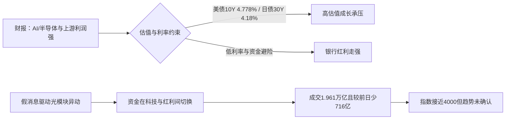

# 📊 每日投资简报 — 2026年9月2日（三·盘前）

> **数据来源**：雪球（29篇）、微博（27篇）、微信公众号（5篇） | 共 **61篇**文章  
> **覆盖时段**：2026-09-01 08:00 ~ 2026-09-02 08:00（北京时间）  
> **覆盖作者**：雪球 12/21 位 | 微博 4/4 位 | 微信 5/5 个  
> **生成时间**：2026年9月2日 盘前

---

## 今日三句话

| 项目 | 内容 |
|---|---|
| 今日最重要变化 | 3995.18点冲高后回落，14:50两市成交1.961万亿元、较前日少716亿元；假光模块消息把资金从红利重新吸向科技又迅速退潮。 |
| 对投资假设的影响 | 财报验证 AI/半导体和上游利润仍强，但高估值成长同时受美债10年期4.778%与去杠杆压制；9月FOMC尚未开会，原假设仍待事件结果。 |
| 今日不做什么 | 不追未经官方确认的政策小作文，不把单日放量或题材上涨当成基本面趋势；多位作者提醒缩量轮动和高波动下要控制仓位。 |

## 零、✅ 上期观察点验证

| 假设ID与关注点 | 关联观点 | 实际结果与证据 | 验证状态 |
|---|---|---|---|
| `H-20260901-001`：沃什放鹰后9月FOMC加息或维持鹰派，长端美债收益率攀升、A股高估值成长承压 | 冰冰小美、三岁小怪兽、睿知睿见讨论美债利率与成长压制；诸葛孔暗把9月18日前后视为关键窗口 | 官方日历显示9月FOMC安排在9月15–16日；截至本期窗口没有会后利率决议、10Y响应和成长/创业板结果，不能确认或证伪（证据：`E-20260902-001`，Federal Reserve） | ⏳ 待验证 |

## 一、💼 博主持仓信息

| 博主 | 持仓/操作 | 原文摘要 |
|---|---|---|
| 三岁小怪兽（微信公众号） | 配置少量 AI，等待突破趋势再加仓；偏好医药、牛奶、猪肉等农产品涨价链 | “手里一点AI没有，随便盘中一拉，会更难受，所以还是老套路，配置一些，等突破趋势再加仓。” |
| Value_at_Risk（微博） | 明确跟踪中国铀业、先健科技、康方生物、思源电气、晨光股份、瑞博生物、联讯仪器、豪迈科技等；多次给出估值与风险约束 | 对中国铀业评价“公司很好，就是估值太贵，现在PE76倍”；对联讯仪器提示“PE 366倍，还是不便宜”。 |
| 我不会选股2019（雪球） | 持有宁德时代、双汇发展；关注长江电力发电量与分红 | “偏偏只买了宁德时代和双汇发展”；判断长江电力发电量达到约3030亿度可基本确保净利润同比不下滑。 |
| 诸葛孔暗（雪球） | 半导体ETF、创业板ETF开始低吸；保持约5成底仓，后续择机加仓 | “我自己也会保持5成底仓不动”；午评称上半月维持5–6成仓位，杀跌可加仓。 |
| 陆家嘴幽灵（雪球） | 关注英伟达、美光、博通及 AI 基础设施链 | 文章末列出英伟达（NVDA）、美光（MU）、博通（AVGO）作为跟踪标的。 |
| 管我财（雪球） | 持有/关注古井贡B | “B股是真的没有人要”，仅为标的状态描述，未给出加仓指令。 |

## 二、📡 博主看好方向汇总

| 博主 | 看好方向 | 看空/回避方向 | 操作建议摘要 |
|---|---|---|---|
| ETF领航员（微信公众号） | 农业、科技（标题表达） | 未明确表态 | 正文可用信息极少，无法补充具体逻辑。 |
| 三岁小怪兽（微信公众号） | 红利+妖股哑铃；医药；农产品涨价链；AI配置 | AI短线仍弱；券商误判 | AI等趋势突破再加仓，承认轮动随机。 |
| 柯中投研笔记（微信公众号） | 未明确表态 | 未明确表态 | 正文无可确认投资观点。 |
| 热点投研（微信公众号） | 化工（涤纶、氨纶、染料、钾肥、制冷剂、轮胎、新材料） | 地产链旺季不确定 | 依据低库存、价差扩张、供给约束和金九银十，强调龙头与业绩。 |
| 猫笔刀（微信公众号） | 低波债基曾优于沪深300；银行等传统行业有资金回流 | 科技去杠杆、消费与地产承压 | 认为债券收益率下行后需重新权衡波动与收益，不追高估值故事。 |
| Value_at_Risk（微博） | AI产业链、石化金属储能、券商、部分创新药/CXO；个股按业绩与估值筛选 | 消费、中游制造、地产、公用事业部分子行业 | 强调“AI产业链的业绩是最好的”，但对高 PE 与集采、汇兑、解禁风险逐项提示。 |
| wu2198（微博） | 银行股；3996点附近区间交易 | 未明确长期看空 | 观察3956–3996震荡，记录成交额与资金流。 |
| 唐史主任司马迁（微博） | 手机、光刻机、长存系；有增量的设备与海外链 | 纯题材逻辑、消费乐观叙事 | 细分方向要看增量与催化，承认盘面很多是资金/筹码交易。 |
| 谢佩德骨头（微博） | 未明确表态；继续用 AI 做研究 | 未明确表态 | 未提供可验证的股票或板块操作方向。 |
| 九洲仙人（雪球） | 趋势投资框架；关注生益科技、恒东光、长飞光纤 | 放量大跌时应跑；前期被套导致被动 | 区分7月放量下跌卖点与8月19日可能买点，等待周五。 |
| 买股票的老木匠（雪球） | 未明确新增方向；强调交易纪律 | 有色、科技风险；白酒长期信仰 | 不把实业偏好当交易逻辑，提醒除权不改变次日博弈价格。 |
| 冰冰小美（雪球） | 主板金融、地产、石油、煤炭、红利股息；农产品/化工化肥链 | 双创在脆弱叠加下易多杀多；高位科技抱团 | 交易能力不足少参与，警惕宏观利空与掩护出货。 |
| 大橘养基桶（雪球） | 银行、红利、高股息；短期趋势强于科技；军工、化工、AI应用为低位辅助 | 科技上方压力、半导体ETF抄底资金过多 | 认为2万亿资金难以同时支撑指数和科技；红利适合低利率环境。 |
| 小豆小瓜_（雪球） | 农业题材、影视题材；红利银行；多资产风险平价 | 电子布扩产过快的过剩风险 | 题材轮动利好小票，同时开始研究低风险策略。 |
| 我不会选股2019（雪球） | 宁德时代、双汇发展、长江电力 | 未明确表态 | 给出宁德时代375–390区间反弹预期，关注长江电力发电量。 |
| 淡淡的相思林（雪球） | 未明确表态 | 未明确表态 | 仅指出台股权重高度集中于硬件科技。 |
| 睿知睿见（雪球） | AI小机器人、AI应用题材；中证红利、银行保险；微盘股 | AI影视变现、流动性收紧下的高估值硬件 | 认为小机器人已出现低价变现案例，但提醒题材最终要验证变现。 |
| 管我财（雪球） | 未明确表态 | 未明确表态 | 仅描述古井贡B流动性弱。 |
| 诸葛孔暗（雪球） | 军工、化工、AI应用；医药、有色、科技延续；半导体ETF、创业板ETF | 纯悲观叙事；不建议单一押注科技 | 上半月5–6成仓位，杀跌可加仓；9月18日前后等待关键窗口。 |
| 陆家嘴幽灵（雪球） | AI基础设施、ASIC、NVLink生态、端侧AI和智能汽车 | 未明确表态 | 将英伟达投资联发科解读为生态绑定，不等同于短线买入建议。 |
| 陈达美股投资（雪球） | 未明确表态 | 光模块未经确认的“假作文”；对高热度IPO保持讽刺 | 强调核验信息源，避免被瞬时消息收割。 |

## 三、⚡ 今日注意事项与投资总结

- **市场情绪**：指数冲击3994/4000未果，窄幅震荡与缩量并存；wu2198记录14:50成交1.961万亿元、2033只下跌，说明赚钱效应并不普遍（作者观点归纳）。
- **重点事件**：光模块“FCC豁免12个月”消息被质疑并回落；大橘养基桶、陈达美股投资均将其作为假消息收割案例（作者观点，非监管结论）。
- **风险提示**：美国10年期国债收益率4.778%、日本30年期4.18%等利率冲击与地缘油价可能压制成长和贵金属；验证中的FOMC假设尚无结论。
- **板块机会线索**：化工低库存/价差/供给收缩逻辑，AI与半导体业绩，银行红利与农业题材分别得到不同作者支持；地产链旺季和AI影视变现仍有分歧。
- **作者操作共识**：不追未经确认的消息，轮动市控制仓位；但对红利防守与低位题材的短线参与程度并无统一意见。

---

## 四、光模块假消息冲高回落：3995点与两万亿资金的再平衡

9月首个交易日的关键不是指数是否摸到4000点，而是消息如何改变资金路径。大橘养基桶记录上证最高3995.18点，资金先从农业、高股息、北证和微盘股转向创业板，随后因消息被辟谣而回落；陈达美股投资转述的核查则指出，所谓“FCC给予12个月豁免”没有明确政策前提，相关账号还存在冒名疑点。

> “一小部分别有用心的人拿着锋利的收割工具……发一些精心包装过的谎言，制造市场波动。”——Value_at_Risk，微博

> “如果有小伙伴上午在最低点‘割肉’，下午看到‘假作文’脑子一热又冲进市场，到了尾盘的时候，可能亏两份钱。”——陈达美股投资，雪球

wu2198给出的盘面锚点是3956–3996震荡区间，14:50成交额1.961万亿元、较前日减少716亿元。诸葛孔暗则认为，科技动起来才可能补上指数压力位留下的缺口。两者共同指向：指数位置尚可，但量能没有证明趋势突破。

## 五、中报利润向 AI 与上游集中，消费和中游制造承压

Value_at_Risk汇总数千份财报：A股上半年营收37.74万亿元、同比增长约7.1%，归母净利润3.58万亿元、同比增长18.57%；科创板净利润同比增长437.6%，创业板增长32.44%。其归因是长鑫等大型公司、半导体爆发及上游涨价，而中游制造单季利润增速为-6.3%，公用事业Q2利润降幅扩大至-13.0%，消费服务降幅扩大至-30.4%。

> “AI产业链的业绩是最好的……其次上游，石化、金属、储能等也不错。”——Value_at_Risk，微博

个股层面，联讯仪器营收同比+209%、归母净利润+903%，但PE约366倍；中国铀业净利+29.08%，PE约76倍；思源电气净利+13.2%，海外业务占比不超过30%但估值仍约33倍。康方生物收入+27.92%却净亏损4.47亿元，先健科技扣非净利同比下降51.9%，这些案例说明“业绩增长”与“股价/估值可承受”并非同一件事。

猫笔刀从资产回报角度补充：其家庭案例中债基十年累计约56%、年化复利约4.6%，沪深300 ETF同期约55%但最大回撤45%；不过2026年债基收益不到2%，低利率正在挤压传统稳健资产的回报。该观点与红利、高股息交易相呼应，却不代表债券或股票的未来收益承诺。

## 六、红利与小票并行，科技等待下一次确认

大橘养基桶称“指数和科技只能保一个”，指出银行批量创历史新高、红利指数在十年期国债收益率1.6845%附近仍具性价比；三岁小怪兽也观察到银行和保险走强，但承认自己站错券商。睿知睿见认为中证红利接近前高，银行保险有业绩支撑；小豆小瓜_则将资金分成游资散户和机构，前者卖科技追农业/影视，后者转红利避险。

> “银行股批量创下历史新高的同时，科技上方压力仍大，金融红利高股息的短期趋势依然强于科技。”——大橘养基桶，雪球

科技并未被所有作者放弃。诸葛孔暗继续跟踪半导体ETF、创业板ETF和AI应用，认为军工、化工、AI软件具备月度攻击能力；陆家嘴幽灵把英伟达35亿美元投资联发科解读为NVLink生态扩张；睿知睿见则把低价机器鸭的订单视为“AI变现”样本，但明确提醒AI影视仍需解决变现问题。

## 七、化工景气与宏观利率：低库存强现实对上高估值脆弱性

热点投研的化工框架是低库存、价差改善和供给受限：地缘事件导致库存处于近6年低位，国内双碳约束限制扩产，海外多家工厂停工；涤纶、氨纶、染料、钾肥、制冷剂、轮胎和新材料被列为重点观察。其判断是金九银十可能带来补库，但地产链可能始终没有旺季。

冰冰小美从宏观传导拆解为“能源价格→化工化肥→农业农产品”，并认为美联储在通胀和财政约束之间两难；大橘养基桶则记录黄金、白银因美元走强、收益率和油价上行而短线承压。两者都把利率和地缘风险视为关键变量，但对是否立即加息、黄金何时重新走强并无确定共识。

## 八、📋 数据覆盖情况

| 来源 | 已覆盖作者 | 缺失作者 | 覆盖率 |
|---|---:|---|---:|
| 雪球 | 12 | DAVID自由之路、古董鱼、suoluos、门捷列夫学徒、柯中、泡沫艺术家、行中衡、躺红利摊转债、润哥 | 57.1%（12/21） |
| 微博 | 4 | 无 | 100%（4/4） |
| 微信公众号 | 5 | 无 | 100%（5/5） |

## 九、🎯 核心矛盾梳理

核心矛盾是“盈利改善是否足以抵消估值、利率与筹码压力”。同一批材料既给出AI业绩爆发，也给出高PE、去杠杆和假消息交易的反例；因此，单日上涨家数或指数点位不能替代盈利兑现和资金持续性。

## 十、🔭 下期关注（待验证假设）

本期无新增假设。历史假设 `H-20260901-001` 的复查期限为2026-09-30，当前状态由 `verification.json` 记录为“pending”；下次复查需等待9月15–16日FOMC结果，并同步观察会后10Y美债收益率与A股成长/创业板表现。

| 假设（含完整ID） | 支持证据（来源） | 反证信号 | 验证期限 | 复查策略 | 状态 |
|---|---|---|---|---|---|
| `H-20260901-001`：FOMC加息或维持鹰派，长端美债收益率攀升并压制高估值成长 | 冰冰小美、睿知睿见对利率压制的讨论；官方日历确认会议日期 | 9月维持利率不变且措辞转鸽，或长端收益率回落、成长相对走强 | 2026-09-30 | 9月15–16日读取FOMC正式声明/点阵图，再配对10Y收益率和成长指数表现 | ⏳ 待验证 |

## 十一、💎 今日精选标的

### 最值得关注的个股/ETF

| 标的代码 | 标的名称 | 推荐理由（来源作者） | 风险提示 |
|---|---|---|---|
|  |  | 今日没有至少2位不同作者明确共同看好的单一股票或ETF；作者更多讨论板块轮动与估值约束。 | 观点分散，且消息驱动波动较大。 |

### 今日最强共识方向

- **红利/银行**：至少三位作者提及或正面描述，包括三岁小怪兽、wu2198、大橘养基桶、睿知睿见；共同论据是低利率、避险资金和相对强势，但三岁小怪兽对券商持仓有反思。
- **AI/半导体产业链**：Value_at_Risk、诸葛孔暗、陆家嘴幽灵、睿知睿见等均有实质讨论；分歧集中在业绩强是否能穿越高估值、利率和去杠杆。

### 编辑说明

本板块基于当日所有作者观点的交叉分析，提取共识度最高的方向。**这不是投资建议**，仅作为信息汇总参考。标的选择应结合个人风险承受能力，关注原文风险提示，并验证支持逻辑是否仍然成立。

---

> **免责声明**：本简报为原始数据的结构化整理，所列观点均来自原作者，不代表任何投资建议。市场有风险，投资需谨慎。  
>  
> *2026年9月2日 · 数据来源：雪球 / 微博 / 微信公众号*
