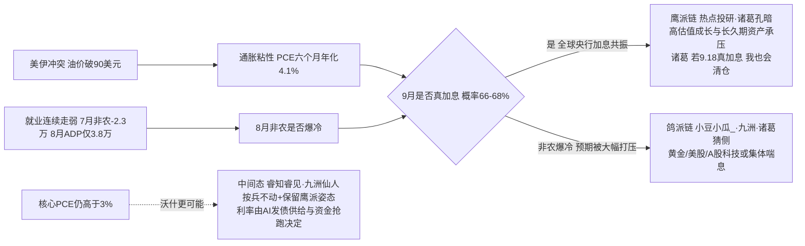

# 📊 每日投资简报 — 2026年9月3日（周四·盘前）

> **数据来源**：雪球（32篇）、微博（22篇）、微信公众号（5篇） | 共 **59** 篇文章
> **覆盖时段**：2026-09-02 08:00 ~ 2026-09-03 08:00（北京时间）
> **覆盖作者**：雪球 13/21 位 | 微博 4/4 位 | 微信 5/5 个
> **生成时间**：2026年9月3日 盘前

---

## 今日三句话

| 项目 | 内容 |
|---|---|
| 今日最重要变化 | 美伊再度交火、WTI盘中破$90，叠加9月FOMC加息概率升至66–68%，全球长端利率齐创新高；A股缩量中阴、成交缩至1.82万亿，约3900只个股下跌。 |
| 对投资假设的影响 | 估值/流动性维度：全球“加息共振”推升实际利率，压制高估值成长（双创）与长久期资产；若周五（9/4）8月非农偏弱，9月加息预期或被显著下调。待验证：8月非农。 |
| 今日不做什么 | 作者共识是控仓+观望、不追高科技股：wu2198“观望等待市场空间明朗再操作为主”；诸葛孔暗明言指数若跌破3924则下看3880/3850再低吸，不预设启动时间。 |

## 零、✅ 上期观察点验证

| 假设ID与关注点 | 关联观点 | 实际结果与证据 | 验证状态 |
|---|---|---|---|
| H-20260901-001（美联储9月利率决议） | 买股票的老木匠：9月议息“义无反顾地加息”；小豆小瓜_：沃什演讲后加息概率升至66%。 | 9月FOMC定于9/15–16，截至本期尚未召开；本期窗口内9月加息概率被主流定价在62–68%（热点投研、九洲仙人），无官方利率决议。 | ⏳ 待验证（等9/15–16 FOMC决议） |

## 一、💼 博主持仓信息

| 博主 | 持仓/操作 | 原文摘要 |
|---|---|---|
| 诸葛孔暗（雪球） | 总仓位约6成；有色、创业板ETF、半导体ETF做T与低吸；日内低点新开IC2612股指期货多单（IM位置偏高未动）；区间3924/3880/3850分批加仓，极限7成，破3850才上8成 | “指数若跌破3924，则下看3880、3850，跌下去了我有足够子弹加仓”“有色早盘暴跌我按计划……超配之上的加仓，然后盘中拉起3%以上全部T掉”。 |
| 谢佩德骨头（微博） | 持有阳光电源、特变电工、中联重科（亏损均超30%）；今日亏0.89%，全年+2.03% | “我阳光电源、特变电工、中联重科亏损都超过30%了”。 |
| 我不会选股2019（雪球） | 持有宁德时代（被套），自选以水电、优质消费/高股息为主 | “这次宁德时代，看起来要砸手里了”“今天盘面感觉不太好，除了水电其他自选股大多都偏弱”。 |
| wu2198（微博） | 观望为主，现金等待方向，未明示个股持仓 | “继续观望等待市场空间明朗再操作为主”。 |
| 小豆小瓜_（雪球） | 长期低相关多资产组合（纳指/沪深300/黄金/债券，全天候思路） | “一个篮子得在美国，一个篮子在中国，还有一个篮子在火星”“明天看A股反弹”。 |

> 说明：谢佩德骨头当日只披露亏损敞口未给新增操作；诸葛孔暗当日做了大量日内做T、仓位净变化不大。其余未明示持仓者不列入。

## 二、📡 博主看好方向汇总

| 博主 | 看好方向 | 看空/回避方向 | 操作建议摘要 |
|---|---|---|---|
| 诸葛孔暗（雪球） | 有色/贵金属（逢暴跌加仓做T）、创业板ETF、半导体ETF、泛科技AI应用、军工 | 指数区间下沿未稳、个股层面纠结科技 | 多做T、不预设启动，3924/3880/3850低吸，破位才上重仓 |
| 唐史主任司马迁（微博） | 军工（国防动员法落地 + 军贸逻辑） | 地缘情绪化追涨 | “今天军工这个，不是地缘不用紧张。于内，是国防动员法。于外，是军贸。” |
| 三岁小怪兽（微信） | 底部高股息消费、新消费（悦己/情绪价值：太空探索、抗衰老方向），等待放量阳线 | 出口优势链（储能、光模块）、AI硬件追高 | “除了控仓，没啥特别好的应对方法”“等放量阳线再跟进” |
| 睿知睿见（雪球） | 中国国债/人民币资产、能创造现金流的低估资产 | 长久期资产、纯题材（影视、种植业已跌）、高位抱团科技 | 利率上行是大趋势，“上行过程中会出现多次惊悚时刻”，等美国出招缓解 |
| 淡淡的相思林（雪球） | 存储链（南亚科8月营收、Q3环比或+60%）、AI算力需求侧 | 认为市场把资本开支主导权定价给了CSP而非硬件商 | “大佬们都说看不到牛了……选择躺平不玩哈哈” |
| 九洲仙人（雪球） | A股硬科技相对美股/韩股偏强，若周五数据好+9月中旬不加息则有望新高 | 中际旭创/新易盛/华丰等少数弱势股 | “倒反天罡？现实吗？”（质疑A股科技独立走强持续性） |
| 大橘养基桶（雪球） | “固收+”（尤其二级债基，机构/保险资金主战场） | 纯债中短端不再是机构首选 | “得‘固收+’者得天下” |
| 躺红利摊转债（雪球） | 四大行（建行/农行第一档，工行/中行第二档）高股息底仓 | 交行、邮储（估值虽低但基本面/融资偏弱） | 收息底仓仍放心，但“四大行股息率从6%降到3.6%，性价比不似之前” |
| 小豆小瓜_（雪球） | 超跌后“明天看A股反弹”；中长线低相关多资产 | 抱团科技（拥挤度跌破45%） | 市场进入第二阶段，挖掘“业绩突出的科技股” |
| 冰冰小美（雪球） | 投机/筹码博弈标的（贵州燃气封板）仍活跃 | 通胀链、宏观正确但被筹码收割的方向 | “泥沙俱下，管你利好利空。纯粹筹码博弈” |
| 陈达美股投资（雪球） | 蔚来（新势力里可投资性最高，长期比亚迪+蔚来“一比二”） | 大多数中国整车、薄毛利制造业 | “龙一是龙一，龙二是龙二，龙三约等于十以后的任何数字” |
| Value_at_Risk（微博） | 中报超预期个股：嘉立创、时代天使、纳微科技、富创精密（拐点） | 新莱应材（食品设备拖累、PE139泡沫）、无催化折价股（中国同辐可等） | “业绩符合/超预期”逐一点评，警惕高估值透支 |
| 陆家嘴幽灵（雪球） | 苹果硬件优先AI（9月折叠iPhone+端侧AI）中长期；存储涨价链 | 高成本零部件、单一设备爆款依赖 | 观察9月折叠iPhone/新Siri能否拉动换机与维持毛利 |
| wu2198（微博） | 沪金走势仍处1258以来调整结构（反抽1015后转跌，现报934） | 日本/韩国股市大跌（-2.85%/-3.99%）情绪 | 观望，等市场空间明朗 |

## 三、⚡ 今日注意事项与投资总结

- **市场情绪**：缩量普跌、无明显增量资金。两市成交1.82万亿、约3900只个股下跌，量能较前一交易日再缩约2316亿元（wu2198）；“成交额前5%个股拥挤度下滑到42.5%，创本轮抱团以来新低”（小豆小瓜_）。
- **重点事件**：① 美伊时隔约1个月再度交火，WTI +4.65%至$89.37（盘中破$90）、布伦特+4.51%至$94.41；② 9月FOMC加息25bp概率被定价至66–68%，关注焦点从“加不加”转向“加多少/加几次”（热点投研）；③ 关键分水岭是周五（9/4）美国8月非农（7月为减少2.3万人）。
- **风险提示**：全球“加息共振”——欧央行9/11、日央行9月加息预期升温、美联储9/15–16，德/法/英/日长端利率齐创新高（热点投研）；30Y美债破5.28%、AI企业债年发行或达2.1万亿美元压制长端（睿知睿见）；若金价失守4350–4400，下看4200，黄金股需防补跌（诸葛孔暗）。
- **板块机会线索**：军工（国防动员法+军贸，唐史主任司马迁）；有色/贵金属逢暴跌低吸做T、创业板/半导体ETF（诸葛孔暗）；四大行高股息与“固收+”（躺红利摊转债、大橘养基桶）；存储涨价链（淡淡的相思林、陆家嘴幽灵）；苹果折叠屏/端侧AI与蔚来（陆家嘴幽灵、陈达美股投资）。
- **作者操作共识**：控仓/观望为主，低吸优于追高，几乎所有给操作建议的作者都强调“做T、等放量、等非农、等方向选择”。以上为作者观点归纳，非编辑建议。

---

## 四、美伊再度交火、油价破$90：一夜之间“避险”与“宽松”叙事同时失灵

本窗口最重磅的外部变量是美伊冲突重启与油价跳涨。热点投研给出完整因果链：

> “美军周日打击Larak Island（霍尔木兹海峡入口）IRGC火箭发射装置；伊朗周一晚向约旦美军基地发射8枚导弹（全部被拦截），近一个月首次直接交火。WTI +4.65%至$89.37（盘中破$90）。”（热点投研，微信公众号）

> “特朗普的新战术是，通过攻击海峡沿岸的伊朗设施，抑制伊朗对船只的攻击能力……这很难成功。”（热点投研，微信公众号）

> “未来每当美国经济数据面临关键选项时期，伊朗大概率都会‘精准’搞事情，就比如周四周五美大小非农就业数据要出来之前。”（诸葛孔暗，雪球）

对市场定价而言，关键不是冲突本身，而是它把“通胀→加息”链条重新点燃——油价升破$90让9月加息概率从“双漂亮数据”压制下的30%多迅速回到60%以上（诸葛孔暗：“一个周末加短短几天时间，川普就又把这个预期翻了一倍”）。黄金并未因避险上涨，反而在“加息预期+实际利率上行+美元走强”三重压制下下跌：金价-2.7%、白银-3.72%（热点投研）。

## 五、全球“加息共振”：长端利率创新高与9月FOMC的“加多少、加几次”

热点投研与睿知睿见两位作者从不同角度指向同一个结论：这一轮利率上行不是“地缘避险”，而是全球加息周期重定价。

> “美债2Y +5.6bps、10Y +4.1bps创2025年1月以来新高、30Y +3.3bps破5.28%。9月FOMC加息25bps概率66-68%……日欧等长端利率同样创出多年新高。”（热点投研，微信公众号）

> “市场会抢跑！利率会在大规模发债前就抬升……AI确实在杀死全球经济。如果资本开支继续加速扩大，利率就还会飙升，从而制约传统经济。”（睿知睿见，雪球）

> “债券供给大幅增加……2026年至今，美国投资级企业债发行量同比增加38%……全年规模将达2.1万亿美元。9月份往往又是企业债发行的高峰期。”（睿知睿见，雪球）

两位作者的侧重点不同：热点投研强调“央行反应函数锁定”（沃什Jackson Hole“we have work to do”、PCE 3.7%/6个月年化4.1%、理事巴尔“若通胀不快速降温将加息”），以及“滞胀风险浮现=范式转移”——“就业弱不再自动等于美联储转鸽”；睿知睿见则把主因归给“AI发债供给”与贝森特“回购长债置换短债”引发的信用折价，并把判断落到“利率上行是大趋势，但惊悚不等于危机”。

对A股的含义同样分层：热点投研提示“甲骨文-5.23%、戴尔-6.80%——AI基建高杠杆概念对长端利率最敏感”；睿知睿见则认为“利率升高对长久期资产带来估值压力，而能创造现金流、低估的资产相对坚挺”，并观察到恒生指数与中概“慢悠悠涨回来”——“之前下跌更多是资金博弈造成的”。

## 六、A股缩量中阴：3924拉锯、双主线杀跌与抱团拥挤度创本轮新低

盘面上，A股当日（9/2）低开杀跌后V型修复部分失地，收出缩量中阴，双创明显弱于大盘。

> “截止15:00两市成交了18203亿元，有3901只个股下跌，大盘资金流出666亿元，量能比上一交易日减少2316亿元！”（wu2198，微博）

> “双主线上午暴跌，AI带崩双创，原油带崩有色，使得指数再一次主动回踩3924……收盘总结：缩量2300亿，总成交只剩1.82万亿的中阴线，3900家普跌。”（诸葛孔暗，雪球）

> “泥沙俱下，管你利好利空。纯粹筹码博弈。哪怕你站在宏观正确的一面，A股也不会让盈利变得轻松。”（冰冰小美，雪球）

结构上，杀跌主力是“双创”：科创/创业板把8月以来的反弹基本跌没了（小豆小瓜_）。小豆小瓜_给出本轮行情最重要的一个结构信号：

> “我刚去拉了下数据，成交额前5%个股的拥挤度，已经下滑到42.5%，创本轮抱团以来的新低。历史上有5次抱团行情，抱团结束的标志就是拥挤度快速下滑到45%以下……接下来，科技股不会再无脑拉涨……市场会进入第二阶段，开始挖掘业绩突出的科技股。”（小豆小瓜_，雪球）

与之互为注脚的是睿知睿见对“抱团瓦解后”的统计规律提示：“过去公募基金在单个一级行业持仓市值占比超20%的情况发生过7次，在抱团瓦解后的半年里，这些超配行业全都跑输了全A指数”。

诸葛孔暗的操作则代表“区间交易派”：早盘有色暴跌低吸→拉起3%以上全部T掉，并开始在IC2612上建仓股指期货多单；他把本轮A股定义为“区间无效且有限波动，等待楔形结构的方向选择”，同时提醒“9月最强分支要从近期重点聊过的几个备选里翻找”。

## 七、ADP小非农爆冷3.8万：美债/黄金/风险资产的一夜反弹

9/2晚公布的8月ADP新增就业仅3.8万人（预期4.8万、前值上修4.6万），连续第二个月低于预期，制造、专业与商业服务就业下滑。它成为压抑已久的市场的一次减压阀：

> “就业数据是加息的重要指标，就业越差，加息概率就越低。今晚数据出来后，美股反转，纳指+0.5%，科技股全线飘红。黄金也快速拉升，从-0.5%一口气拉到+1.5%。”（小豆小瓜_，雪球）

> “数据公布后，市场对美联储9月维持利率不变的概率降至37.8%，加息25个基点的概率升至62.2%。”（九洲仙人，雪球，整理9/2晚数据）

但九洲仙人点出“就业走弱+通胀仍高”的矛盾结构：ISM制造业价格支付指数71.1、油价升破$90、PCE三个月年化3.0%/六个月年化3.5%仍远高于2%目标——因此市场定价方向是“就业弱不足以阻止加息，通胀仍是首要考量”。wu2198 转述隔夜美股表现：“英伟达、美光、高通、甲骨文等科技股涨幅领先。收盘道指涨295点，纳指涨118点”。真正的方向之争被推到周五（9/4）8月官方非农。

## 八、军工与“新防守”资产：从国防动员法到四大行到固收+

在科技主线杀跌的窗口，防御类与事件驱动类资产获得作者们的集中讨论。

> “今天军工这个，不是地缘不用紧张。于内，是国防动员法。于外，是军贸。逻辑其实是有效的，这些事周一就明确了，但更多还是市场看不看逻辑。”（唐史主任司马迁，微博）

高股息/固收一侧，作者更强调“机构行为”而非单纯避险：躺红利摊转债以六大行中报论证四大行（建行/农行第一档、工行/中行第二档）作为“A股定海神针”，但提醒股息率已从6%滑到3.6%；大橘养基桶用基金中报数据指出“得固收+者得天下”，机构资金正从中短债向二级债基迁移（上半年“固收+”增量的绝对大头来自机构，出现“零售赎回、机构申购”）。“固收+”榜单与“军工股大涨”同时出现在其话题标签下，反映当日资金的两条典型去向。

小豆小瓜_还补充了两条扰动信息：荷兰将86吨黄金储备从美加转存伦敦（“全球主权国家对美元越来越不信任”）；李蓓私募单日净值暴跌-9%，市场推测其重仓港股地产（当日港股绿城-17%、华润-9%）。

## 九、科技链新信号：存储“涨价”被重新定价，苹果换帅与蔚来财报

在AI硬件情绪冰点下，作者们对“存储”与“供应链成本”给出了新的观察：

> “南亚科一般是季度初调价……假设九月与八月营收持平，预计其Q3的环比营收增速将高达60%+，基本与Q2环比增速持平，达到美光Q3指引增速的三倍。”（淡淡的相思林，雪球）

> “供应链涨价的部分其实也是英伟达营收增长的一部分，他同样转嫁给了客户，要是没这个涨价，英伟达也未必有这个营收增速。”（淡淡的相思林，雪球）

> “（苹果电话会）也提到了‘百年一遇’的存储定价问题，这也导致其产品毛利率受到显著挤压……全球DRAM等零部件价格上涨时，能否维持毛利率中枢。”（陆家嘴幽灵，雪球）

陆家嘴幽灵长文拆解苹果换帅：库克十五年把市值从约3500亿美元带到超4.7万亿；新任CEO特努斯是硬件工程师，走“硬件优先的AI战略”——9月折叠iPhone内存据传提升至12GB以支撑端侧AI，新版Siri采用谷歌Gemini作底层大脑，并收缩Vision Pro团队转向轻量智能眼镜/AirPods等形态。其核心判断：苹果的AI变现靠硬件溢价+服务订阅，三个观察点是9月折叠屏换机潮、新形态硬件工程能力、以及能否消化存储涨价带来的毛利压力。

陈达美股投资则以蔚来Q2财报给出对“逆势增长消费/制造”的样本：蔚来Q2营收321.4亿元、同比+69.1%，上半年营收/利润均为新势力第一，整车毛利率18.5%（同比+8.2pct）、实现连续三季度盈利，主品牌ASP连续两个月破40万（7月ES9均价55.67万）；他继续“比亚迪+蔚来”两个就够的框架，但提示Q3指引环比几乎走平、隐含9月约3.6–3.9万交付，“说明下一轮增长需要新变量”。

Value_at_Risk 当日密集点评中报，质量分化明显：超预期的是嘉立创（26H1营收+54.13%/净利+73.54%）、时代天使（收入+42.9%/经调净利+80%，海外放量）、纳微科技（Q2扣非+118%，小核酸/GLP-1上游）；富创精密利润拐点确立（扣非扭亏、Q2净利+121%）但“PE 522倍……股价透支太厉害”；被看淡的是新莱应材（食品设备拖累、PE139“泡沫较大”）与映恩生物（港股疲软但“科创板上市在即，预计A股明显溢价，或带动港股修复”）。

## 十、📋 数据覆盖情况

| 来源 | 已覆盖作者 | 缺失作者 | 覆盖率 |
|---|---|---|---|
| 雪球 | 13 位（九洲仙人、买股票的老木匠、冰冰小美、大橘养基桶、小豆小瓜_、我不会选股2019、柯中、淡淡的相思林、睿知睿见、诸葛孔暗、躺红利摊转债、陆家嘴幽灵、陈达美股投资） | DAVID自由之路、古董鱼、suoluos、门捷列夫学徒、管我财、泡沫艺术家、行中衡、润哥 | 62% |
| 微博 | 4/4 位（Value_at_Risk、wu2198、唐史主任司马迁、谢佩德骨头） | 无 | 100% |
| 微信公众号 | 5/5 个（ETF领航员、三岁小怪兽、柯中投研笔记、热点投研、猫笔刀） | 无 | 100% |

## 十一、🎯 核心矛盾梳理

**本日矛盾：美联储“9月非加不可”（概率66–68%）vs. 疲弱就业“随时可能把预期打回去”——A股在哪个假设下定价？**

**留给验证的关键阈值**：8月非农（9/4）→ 决定9月加息预期是否松动；COMEX金价4350–4400（失守则下看4200，黄金股防补跌）；两市成交额能否放量走出1.8万亿地量。这些数字全部来自本期文章原文，非编辑外推。

## 十二、🔭 下期关注（待验证假设）

| 假设（含完整ID） | 支持证据（来源） | 反证信号 | 验证期限 | 复查策略 | 状态 |
|---|---|---|---|---|---|
| H-20260903-001：COMEX金价趋势支撑4350–4400一线，若失守则下探4200（作者此前确认的黄金启动点），黄金股面临补跌 | 诸葛孔暗：金价“在4350-4400的趋势位迎来强力抵抗……要么这里频繁争夺等待非农数据，要么撑不住，彻底再向下去找4200”（雪球） | 非农/CPI后市场转鸽、实际利率回落使金价收复4400并站稳，或金价放量跌破4200/黄金股明显补跌 | 2026-09-18 | 每周 | 待验证 |
| H-20260903-002：A股科技抱团以拥挤度跌破45%（现42.5%）确认瓦解后，市场进入“第二阶段”，从无差别拉升转向挖掘业绩突出的科技股 | 小豆小瓜_：拥挤度42.5%创新低、历史上5次抱团结束的标志是拥挤度快速跌破45%；“不会再无脑拉涨……开始挖掘业绩突出的科技股”（雪球） | 两市成交额重新放大至2.5万亿+使拥挤度回升至45%上方、科技再度普涨，或业绩龙头继续补跌并拖累双创创新低 | 2026-09-30 | 每周 | 待验证 |

> 复核提示：H-20260903-001/002 与历史假设（美联储利率决议、科技小盘风格延续等）关注维度不同，非近义重复，故未与 `hypothesis-dedup-index.json` 内条目合并。

## 十三、💎 今日精选标的

基于当日所有作者观点的交叉分析，汇总共识度最高的标的和方向。

### 最值得关注的个股/ETF

| 标的代码 | 标的名称 | 推荐理由（来源作者） | 风险提示 |
|---|---|---|---|
| — | 军工方向（国防动员法+军贸） | 唐史主任司马迁明确“军工逻辑有效”（内：国防动员法；外：军贸）；诸葛孔暗将“泛科技AI应用和军工”列为科技股外的可做分支 | 唐史提醒“更多是市场看不看逻辑”；缺乏公司层面公告支撑时易情绪化回落 |
| — | 存储/DRAM涨价链 | 淡淡的相思林：南亚科Q3环比或+60%、存储季度初调价；陆家嘴幽灵以苹果“百年一遇”存储定价问题佐证涨价持续性 | 涨价已部分定价于股价；若AI资本开支放缓则涨价动能衰减 |

> 今日极少出现同一标的被两位作者“明确看好”的情形，多数为方向性讨论，故不强行凑列。以上两条为“方向+至少两人提及”的近似共识，非个股推荐。

### 今日最强共识方向

- **防守/高股息资产（4位作者提及）**：三岁小怪兽（底部高股息消费）、躺红利摊转债（四大行收息）、大橘养基桶（“固收+”机构配置）、我不会选股2019（优质消费/高股息托底）。
- **军工（2位作者提及）**：唐史主任司马迁、诸葛孔暗。
- 说明：本轮共识更偏“撤向防守”，而非单一进攻主题；科技与存储虽被讨论多，但作者间方向存在分歧（如淡淡的相思林躺平 vs 九洲仙人质疑A股独立走强）。

### 编辑说明

本板块基于当日所有作者观点的交叉分析，提取共识度最高的标的和方向。**这不是投资建议**，仅作为信息汇总参考。标的选择应：
- 结合个人风险承受能力
- 关注原文中的风险提示
- 验证支持逻辑是否仍然成立

---

> **免责声明**：本简报为原始数据的结构化整理，所列观点均来自原作者，不代表任何投资建议。市场有风险，投资需谨慎。
>
> *2026年9月3日 · 数据来源：雪球 / 微博 / 微信公众号*
