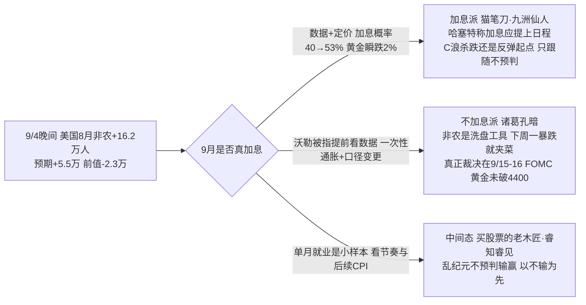
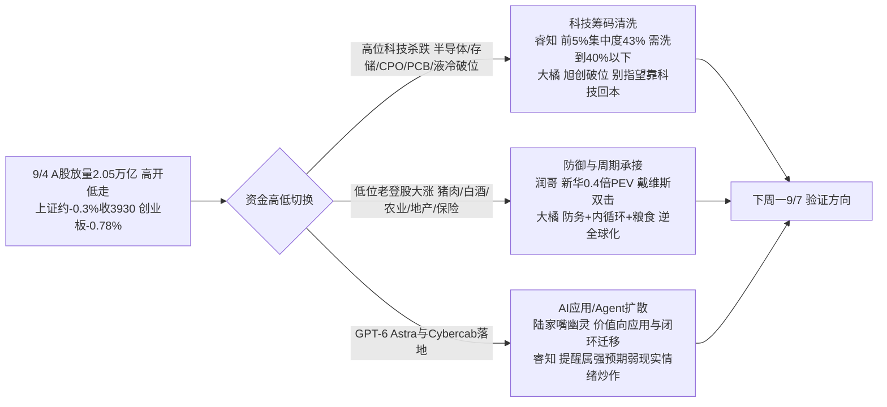

# 📊 每日投资简报 — 2026年9月5日（周六·盘前）

> **数据来源**：雪球（38篇）、微博（24篇）、微信公众号（3篇） | 共 **65** 篇文章
> **覆盖时段**：2026-09-04 08:00 ~ 2026-09-05 08:00（北京时间）
> **覆盖作者**：雪球 13/21 位 | 微博 3/4 位 | 微信 3/5 个
> **生成时间**：2026年9月5日 盘前（周末简报；下个A股交易日为9月7日周一）

---

## 今日三句话

| 项目 | 内容 |
|---|---|
| 今日最重要变化 | 昨晚（9/4）美国8月非农**大超预期**：+16.2万人（预期+5.5万、前值-2.3万），9月加息25bp概率从40%跳升至53%，黄金瞬跌2%；周五A股放量至2.05万亿高开低走、科技破位而猪肉/白酒/农业/地产等“老登股”大涨。 |
| 对投资假设的影响 | 非农“过热”重新点燃9月加息预期，但沃勒（美联储副主席）被指“提前看到数据”并渲染“一次性通胀+9月统计口径变更”，加息与否的博弈被推到9/15–16 FOMC；下周初海外（尤其非美市场）或剧烈波动。 |
| 今日不做什么 | 分歧极大：诸葛孔暗“暴跌就夹菜、下周一加到7–8成”，买股票的老木匠则“乱纪元不试图战胜风险、以不输为先”；周五追高科技者当天下杀即被套。多位作者强调别做右侧、别在恐慌中割肉，也勿在高位科技上抄底接力。 |

## 零、✅ 上期观察点验证

| 假设ID与关注点 | 关联观点 | 实际结果与证据 | 验证状态 |
|---|---|---|---|
| H-20260901-001（美联储9月利率决议） | 沃什放鹰后9月或加息，长端美债攀升、A股高估值成长承压 | 9月FOMC仍定于9/15–16；8月非农+16.2万远超预期（预期+5.5万）后，链上预测9月加息25bp概率从40%跳涨至53%、9月不变概率从60%降至47%，黄金瞬跌2%（媒体/社交转述）；沃勒此前被解读为“提前看到数据”、华尔街渲染口径变化找补。FOMC决议尚未发生 | ⏳ 待验证（等9/15–16 FOMC） |

## 一、💼 博主持仓信息

| 博主 | 持仓/操作 | 原文摘要 |
|---|---|---|
| 诸葛孔暗（雪球） | 有色为主仓：早盘趁高开第一次做反T（减一成有色高抛），尾盘针对暴跌有色股加仓、并**第一次买入半导体ETF**（量能为8/19以来最大）；下周计划7–8成 | “破3924那一刻大概率收盘还会找回来，我针对有色尤其是暴跌股做了一轮加仓，并且对暴跌的半导体etf做了第一次买入”“周一到7周二到8成，暂且这样计划”。 |
| 润哥（雪球） | 中国海洋石油、新华保险（“我的仓位，继续拿好，收息，等戴维斯双击”） | 新华中报净利227.93亿+54%、PEV仅0.4、股息率6.3%、分红率30%+；“港股寿险PEV普遍砸在0.4-0.7倍的历史低位”。 |
| 睿知睿见（雪球） | 持有低估/周期底资产（提及豆粕等农产品配置，买入逻辑是周期底部而非天气）；保险估值修复 | “咱们持有的大都是估值偏低的资产了，低估的时候，得主动承受波动”“豆粕ETF再创新高……我们当时配置的时候，买入逻辑并不是天气，而是周期底部”。 |
| wu2198（微博） | 观望为主、现金等待 | 创业板“3300区域连续压3根阴线，这种举动是非常坏的”；成交额重上2万亿但冲高回落。 |

## 二、📡 博主看好方向汇总

| 博主 | 看好方向 | 看空/回避方向 | 操作建议摘要 |
|---|---|---|---|
| 诸葛孔暗（雪球） | 泛科技里“唯一能买的军工和AI应用”；有色暴跌加仓、半导体ETF首次买入 | AI产业链“反弹不是反转”，双创大多数个股未到反转时机 | 别做右侧、恐慌中夹菜；即便再杀一次也不看空、不建议任何人在这里止损 |
| 陆家嘴幽灵（雪球） | AI应用/垂直闭环、算力基建（上游卖水人）远未见顶 | 基于席位收费的SaaS | 关注能否跑通“按任务效果付费”闭环；警惕Astra安全与可监控性风险 |
| 买股票的老木匠（雪球） | 现金与“不输”思维；日元贬值长期更利日本化债 | 试图战胜风险、追“信誓旦旦”的方向；房地产开发行业（拐点未现） | “现在是先确定输家的阶段，主要任务不是赢，而是不输” |
| 睿知睿见（雪球） | 低估/硬资产、保险（估值修复）、农产品/豆粕（周期底） | 高位硬件（筹码需长时间清洗）、对AI炒作向应用扩散持“需催化剂”谨慎 | 关注“加息节奏”而非“是否加息”；快速轮动难超两月，快到变盘 |
| 唐史主任司马迁（微博） | 算力租赁（有增量、较稳）、电力（高可靠供电，等事件触发）、液冷-金刚石-电源分支 | 银行等金融配置增量基本结束；科技仅能容纳一两个分支 | 做多氛围好转但量能缩减，只能缩容做细分；“核心看量能” |
| 大橘养基桶（雪球） | 金融/军工（防务）、内需/粮食（内循环） | 高位科技（旭创已破位，再下杀10-20%概率不低）、“靠科技回本”执念 | “放下对科技的执念”；黄金要过三关（大非农/CPI/沃什FOMC） |
| 柯中（雪球/微信） | 锂/碳酸锂（供不应求趋势、储能订单排到明年Q2、负库存） | SMM第三方库存数据“手搓”失真 | 别盯单一库存数字，跟踪供需趋势是否结束 |
| 润哥（雪球） | 保险（新华0.4倍PEV+6.3%股息，戴维斯双击剧本） | — | PEV 0.4-0.7低位买入、拿负债端复利、收息，权益牛当放大器 |
| 淡淡的相思林（雪球） | 存储供给受限（两长明年产能远逊预期）是“产业机会之二” | A股烂发行、纯变现的新股 | 先等筹码出清 |
| ETF领航员·机构观点（微信） | 证券、保险、有色、通用设备；红利底仓、半导体逢回调分批 | 业绩预期过高而兑现不足的题材 | 9月FOMC为核心观察节点，指数或继续震荡，结构再平衡 |
| 猫笔刀（微信） | 期指贴水高位移仓远月（ic年化9.78%/im 11.28%） | 高位波动追涨 | AI agent辅助盯盘+自身筛选扩展的取舍 |
| 陈达美股投资（雪球） | 百度AI全栈（双重上市、AI云+昆仑芯）、robotaxi（对标Waymo） | — | 用SOTP看百度，AI资产获独立定价 |
| 九洲仙人（雪球） | “不预判只跟随”，关注C浪杀跌还是反弹起点 | A股高开低走顽疾、量化反着来 | 警惕“通胀失控→连续加息→衰退”才是科技股真正杀手 |

## 三、⚡ 今日注意事项与投资总结

- **市场情绪**：周五（9/4）A股“冰火两重天”。早盘高开一度约5000家上涨，随后冲高回落、午后恐慌杀跌，尾盘V起守住3924；三大指数收跌（上证约-0.3%收3930一线、深成指-0.79%、创业板-0.78%、科创50领跌）。成交**20510亿元、放量2708亿元**，属于“下跌中放量+恐慌盘”性质（wu2198、ETF领航员、诸葛孔暗）。
- **盘面结构**：猪肉/养殖（罗牛山、新希望等涨停）、白酒（泸州老窖+5%）、农业种业、房地产、保险/金融、军工（长城军工、中国船舶涨停）与AI应用/传媒（易点天下+11%、龙版传媒5连板，GPT-6 Astra催化）领涨；半导体产业链（存储/CPO/PCB/液冷）集体大跌，华虹宏力等跌超10%、浪潮信息一度逼近跌停、半导体设备ETF -3.1%。
- **重点事件**：① 9/4 20:30美国8月非农+16.2万（预期5.5万）——大超预期，9月加息概率40%→53%（猫笔刀）；② 白宫经济顾问哈塞特同日称“加息是大家认为应该提上日程的、尊重美联储独立性”（财联社）；③ 但美联储副主席沃勒被指“提前看到非农”，其“给通胀多一些时间/一次性通胀”说法与华尔街渲染的“9月起统计口径变更”正在被用来找补（诸葛孔暗）；④ GPT-6 Astra与特斯拉Cybercab同日落地（陆家嘴幽灵）。
- **风险提示**：高位科技（半导体/算力硬件）筹码拥挤、机构扎堆，上方套牢盘重，“硬件板块还需要较长时间洗干净筹码，前5%成交集中度43%、估计还会回落到40%以下”（睿知睿见）；大橘养基桶与诸葛孔暗共同点名“旭创破位”；民间大V看空占比59%，代表观点称“C浪调整、下周或考验3900”。
- **作者操作共识**：一派（诸葛孔暗为代表）认为非农是“洗盘/割韭菜”工具、越临近议息越制造恐慌，主张下周暴跌继续加仓到7–8成；另一派（老木匠、九洲仙人）更谨慎——“不输为先”“不预判只跟随”。共同点：都不建议在当前位置恐慌性止损科技，也都提示别去高位追右侧。以上为作者观点归纳，非编辑建议。

---

## 四、8月非农“爆表”：9月加息概率40%→53%，沃勒的提前量与被重新叙述的“口径”

9/4晚间美国8月非农以16.2万（市场预期5.5万）大幅击穿预期，是本窗口最重的宏观变量。猫笔刀给出即时定价：

> “美国公布8月非农就业数据，增加16.2万人，这个数据远远高于市场预期的5.5万人，前值为减少2.3万人……给9月份美联储加息狠狠推了一把。数据公布后链上赌场关于9月份加息0.25%的概率从40%跳涨至53%，原本9月份利率不变的概率从60%下调至47%。受此影响黄金瞬跌2%，区块链上的资产也都普跌2-3%。”（猫笔刀，微信公众号）

诸葛孔暗则抛出另一层解读——美联储副主席沃勒“提前看到了这份数据”，所以前夜才敢放鸽：

> “沃勒说：给通胀多一些时间，我们可以确定目前的通胀是由就业传导而非其他原因……都是一次性通胀而非持续性……今天看来他确实提前看到了这份非农数据……并将其定义为‘一次性’，其中有5万人增加在餐馆服务，4万人增加在教育，这两项都加得很奇怪。”（诸葛孔暗，雪球）

他判断无论如何找补，“加息预期肯定会大幅度走高”，并提示一个时间差机会：

> “尤其这个周末发酵后下周一全球股市一开，血雨腥风，但唯独美股自己下周一不开盘。这是一次非常好的洗盘机会，下周如果有暴跌，继续加仓，继续买。”（诸葛孔暗，雪球）

买股票的老木匠则提醒别被单边情绪带走，同时记录了一个反常信号——周五晚美股指数收跌但芯片、半导体与存储类大涨：

> “昨晚美股的芯片半导体类大幅上涨……最大可能是在预期中美贸易关系出现缓和，而一旦如此，这些芯片股无疑是最受益的。与此同时，与此对标的A股企业反倒容易受损……昨天的人民币兑美元汇率出现了一小波快速的上涨，并且在下午的时候，在科技股的带领下，股指出现了下跌。”（买股票的老木匠，雪球）

> “现在很多大V都开始改口，利空出尽是利好了。反正不加息是利好，降息是利好，加息依然是利好。”（买股票的老木匠，雪球）

## 五、A股冰火两重天：放量2.05万亿高开低走，“老登股”围殴“小登股”

周五A股把“结构极端分化”演绎到极致。ETF领航员（微信）的复盘标题即概括：“老登股集体围殴小登股”——猪肉、农业、白酒、房地产集体大涨，而芯片产业链跌势扩大。

> “猪肉、农业、白酒、房地产这些平时‘狗都不理’的板块，今天集体大涨特涨，罗牛山、天邦食品直接涨停，而另一边，芯片产业链跌势扩大，华虹宏力等多股跌超10%，千亿级别的浪潮信息在跌停板附近晃悠。”（ETF领航员，微信公众号）

关于“为什么”，市场给出多个解释：高低切换（高估值科技→低估值防御）；上海住建“十五五”住房供应大缩水+可售保障房停摆的地产政策利好；猪价走出周期低谷、产能调减提前至三季度末的周期反转预期；也有“长存上市前资金腾挪”“担忧晚间非农情绪谨慎”“量化早盘买入90亿、午后卖出26亿”等说法。

对下周的分歧同样白热化。ETF领航员汇总的机构/技术派认为“连续三日缩量阴线属洗盘、科创50与创业板指已回落至日线前期低点附近，具备止跌反弹条件”；而民间大V看空占59%，代表观点认为“B浪扩张后C浪调整压力较大、下周或考验3900支撑”。wu2198 强调创业板“3300区域连续压3根阴线，非常坏”，但也指出“试破3286不收破”保留一线希望，下周继续观察3286得失。

## 六、诸葛孔暗的“楔形尾声”：反T、夹菜与第一次买半导体ETF

本窗口诸葛孔暗的完整操作与心路，几乎是一个人形的“楔形结构进度条”：早盘高开他做了一次反T（减一成有色），午后提示“这么跌可以夹菜了”，尾盘对暴跌有色加仓并对半导体ETF开“第一枪”。

> “早盘趁着高开我近期第一次做了反T……下午2:40的时候我就在提醒，这么跌可以夹菜了，破3924那一刻大概率收盘还会找回来，我针对有色尤其是暴跌股做了一轮加仓，并且对暴跌的半导体etf做了第一次买入。”（诸葛孔暗，雪球）

> “半导体etf，今天的量是自8.19号之后最多的，量能的明显异动可以成为众多技术指标里我认可下手的一个因素，所以我动了。”（诸葛孔暗，雪球）

他对科技的态度同样明确——参与但定义为反弹，不是反转：

> “科技股我这一次必然参与，不是因为看好，是因为好东西在现阶段有好价格……AI科技在这里无论反弹多强，都不是反转……吃一波反弹过后我就会走。”（诸葛孔暗，雪球）

> “祝各位周末愉快，我今天也亏小2%呢……楔形结构快走完了，离出头很近了。”（诸葛孔暗，雪球）

## 七、“日本再度牺牲自己救了美股”：被忽略的流动性主角

睿知睿见给出一套与“加息预期降温”不同的解释框架：周四夜的美股/黄金/比特币大涨，真正推手不是美联储转鸽，而是日本央行行长植田和男在G20后的表态。

> “真正的推手来自日本……本来已经突破160了，正准备继续贬值下去了，谁料想突然被拉到了155左右……植田和男……明确表示，日本央行会在9月会议上‘认真讨论’进一步加息……市场认为日本加息的概率提升到80%！”（睿知睿见，雪球）

> “每次日元在抵达160这个关口的时候，日本都会站出来为美国挡枪！”（睿知睿见，雪球）

睿知的结论是：日元的短期升值缓解了美元流动性，利于美股美债，但“日元贬值的大趋势不会改变，日本的操作只是拖延而已”。他更想强调的是节奏而非方向——只要美债利率上升节奏不快，“反而利于股市上涨”，“咱们持有的大都是估值偏低的资产了，低估的时候，得主动承受波动”。大橘养基桶则补充了美债侧的另一条操作：“贝嫂的财政部刚从市场回购了125亿美元的短期债务，这是超过3个月以来最大规模的回购。从9月9日起，长期债券回购规模翻倍，实质上已经是YCC了，但和40万亿美元的存量债务相比，杯水车薪。” 买股票的老木匠继续其日元专题，指出要区分影响汇率的短期（两国利率）与长期（购买力）因素，两者再经由货币供需影响汇率。

## 八、科技叙事裂变：GPT-6 Astra与Cybercab，以及“AI炒作向应用扩散”

陆家嘴幽灵以长文串联两件事——OpenAI发布旗舰模型GPT-6 Astra与特斯拉Cybercab在奥斯汀落地——并称这指向AI叙事的迁移。

> “Astra……能够像一个熟练的白领一样，自主打开专业软件干活……在电子工程领域，它可以直接进入KiCad软件，根据原理图完成PCB的布局走线……该模型在星际之门超算基地完成预训练，动用超过10万块GPU集群。”（陆家嘴幽灵，雪球）

> “目前已有45辆Cybercab完成注册并开启无安全员的付费载客运营，未来规划年产能最高达12.5万台。设定的运营成本目标是每英里约0.2美元，远低于传统网约车。单车制造成本被控制在3万美元以下，而竞品Waymo的单车成本高达7-15万美元。”（陆家嘴幽灵，雪球）

> “算力基建远未见顶。无论是Astra超10万张GPU的训练规模，还是FSD V15参数量10倍的膨胀……上游卖水人依然具有高景气度和确定性。”（陆家嘴幽灵，雪球）

与之呼应，A股资金已经开始“向应用/软件扩散”：AI应用与文化传媒走强（易点天下+11%、龙版传媒5连板），睿知睿见观察到“影视传媒大涨3.39%、种植业炒厄尔尼诺大涨3.2%、养殖板块涨4.4%”，并直言“这些都属于强预期弱现实”，当前炒的是一套“AI应用（短剧/办公）+农业天气”的情绪叙事；陈达美股投资则从百度双重上市切入，论证国产AI“全栈”资产（昆仑芯+AI云+文心+萝卜快跑）在A股估值语境下的想象空间。门捷列夫学徒与猫笔刀同时聊到AI Agent的日常使用，后者已在用量化工具辅助决策。

## 九、产业与个股纵深：存储供给之辩、碳酸锂库存之“谜”、保险的戴维斯双击

在交易层面之外，几个产业链判断值得单列。

**存储（淡淡的相思林）**：连发多条强调“供给测算被高估”这一反共识点——

> “因为现在设备交付6-8个月，装机爬坡6-8个月，已经开始能见到明年各大fab能开出多少万了……现在的主流观点基本把国内新增存储产能多估计了相当于一个三星每年新增的体量出来。”（淡淡的相思林，雪球）

**碳酸锂（柯中，微信公众号/雪球）**：同日长篇质疑SMM库存样本“一次性扩充9.4万吨、占55%、声称覆盖100%样本”，并认为“真正的上涨是预期大于现实”，供需关系早在去年已逆转——

> “据我了解到的所有储能企业，订单已经排到了明年Q2（这基本是下了订金，确定提货，且没有拆单的订单）。很多企业明年一年的订单都订出去了。你们还在质疑需求？”（柯中投研笔记，微信公众号）

**保险（润哥）**：把新华保险定位成“一张打了四折的牛市看涨期权，期权费每年先付你6.3%”——

> “港股寿险的PEV普遍砸在0.4-0.7倍的历史低位区间……保险行业目前2.5-5倍市盈率……市场确信保险是‘价值毁灭器’，无人愿意付钱。”（润哥，雪球）

**新股市况（Value_at_Risk）**：点评本周5只新股“没有亮眼的、都很一般”，港股打新几乎都破发；康方生物HARMONi-2 OS期中阳性（HR=0.51），但“市场更想看的是HARMONi-7/3，港股有多弱可见一斑”。

## 十、📋 数据覆盖情况

| 来源 | 已覆盖作者 | 缺失作者 | 覆盖率 |
|---|---|---|---|
| 雪球 | 13 位（九洲仙人、买股票的老木匠、古董鱼、大橘养基桶、柯中、润哥、淡淡的相思林、睿知睿见、管我财、诸葛孔暗、门捷列夫学徒、陆家嘴幽灵、陈达美股投资） | DAVID自由之路、suoluos、泡沫艺术家、行中衡、躺红利摊转债、我不会选股2019、小豆小瓜_、冰冰小美 | 62% |
| 微博 | 3/4 位（Value_at_Risk、wu2198、唐史主任司马迁） | 谢佩德骨头 | 75% |
| 微信公众号 | 3/5 个（ETF领航员、柯中投研笔记、猫笔刀） | 三岁小怪兽、热点投研 | 60% |

## 十一、🎯 核心矛盾梳理

**本日矛盾一（宏观）：非农“过热”是否意味着9月真的要加息（概率53%）？——沃勒的提前量 vs 华尔街的“口径”找补**

**本日矛盾二（结构）：高位科技（筹码拥挤）的补跌 vs 低位“老登股”/AI应用的高低切换，谁是下一阶段主线？**

**留给验证的关键阈值**：下周一（9/7）A股如何为“非农超预期+隔夜美股指数收跌但芯片/存储大涨”定价；两市能否守住2万亿量能、上证3924与创业板3286（已试3266）支撑是否有效——将决定高位科技的恐慌是“洗盘买点”（诸葛孔暗）还是“C浪起点”（九洲仙人一侧）。以上均出自本期文章原文，非编辑外推。

## 十二、🔭 下期关注（待验证假设）

| 假设（含完整ID） | 支持证据（来源） | 反证信号 | 验证期限 | 复查策略 | 状态 |
|---|---|---|---|---|---|
| H-20260905-001：市场（含大摩等外资行）对国内两大存储厂明年新增产能的测算偏高，按设备交付+装机爬坡周期实际或仅及预期约七成，2027年国产存储供给放量将被修正、存储价格高景气或超预期延续 | 淡淡的相思林：设备交付6–8月+装机爬坡6–8月，“主流观点多估了相当于一个三星年增量”“两长明年开出产能远逊于市场给吹的规模”（雪球） | 两长等公开扩产进度达到/超过预期、良率爬坡顺利，或存储现货价格明显回落 | 2027-03-31 | 每周 | 待验证 |
| H-20260905-002：特斯拉Cybercab在奥斯汀无安全员付费载客运营（45辆注册、规划年产12.5万台、单车<3万美元、约0.2美元/英里）标志robotaxi进入规模化拐点，商业模式向“AI运力平台”演进并带动产业链重估 | 陆家嘴幽灵：Cybercab运营细节与“AI运力平台”定位；陈达美股投资：Waymo/特斯拉起量、萝卜可直接对标Waymo（雪球） | Cybercab年内复制扩张停滞、发生重大安全事故/监管收紧，或Waymo/萝卜等竞品明显占主导 | 2026-12-31 | 每周 | 待验证 |

> 复核提示：H-20260905-001 聚焦“供给侧测算被高估”，与既有 H-20260901-003（需求/国产HBM突破）关注面不同；H-20260905-002 为全新主题，未与 `hypothesis-dedup-index.json` 内条目重复。

## 十三、💎 今日精选标的

基于当日所有作者观点的交叉分析，汇总共识度最高的标的和方向。

### 最值得关注的个股/ETF

| 标的代码 | 标的名称 | 推荐理由（来源作者） | 风险提示 |
|---|---|---|---|
| SH601336 / 01336 | 新华保险（A/H） | 润哥：0.4倍PEV+6.3%股息+分红率30%+，戴维斯双击剧本；大橘养基桶、睿知睿见同步提示保险估值修复（港股寿险PEV 0.4-0.7历史低位） | 投资收益占利润约2/3（牛市放大器双向通电）；6.3%股息建立在2025高基数上 |
| — | 军工方向（长城军工、中国船舶等） | 诸葛孔暗：泛科技里“唯一能买的军工和AI应用”；大橘养基桶：#军工股大涨，长城军工等多股涨停#并列为防务主线 | 依赖市场认可逻辑而非公司公告时波动大；周五已大涨，谨防追高 |
| — | AI应用/传媒方向 | ETF领航员：AI应用表现活跃（易点天下+11%、龙版传媒5连板）；睿知睿见：AI炒作向应用扩散；陆家嘴幽灵：价值捕获转向应用/垂直闭环 | 睿知直言属“强预期弱现实”；多数AI应用变现闭环未通，题材化波动大 |

### 今日最强共识方向

- **保险/金融红利（4位以上作者提及/利好）**：润哥（新华戴维斯双击）、睿知睿见（保险估值修复创新高）、大橘养基桶（金融红利趋势明显好于科技）、ETF领航员机构观点（关注券商保险）。
- **AI应用/Agent（4位以上作者提及）**：ETF领航员（盘面+机构）、睿知睿见（AI炒作向应用扩散）、诸葛孔暗（AI应用为泛科技可买方向）、陆家嘴幽灵（Astra=Agent范式）、门捷列夫/猫笔刀（AI Agent日常使用）。
- **军工（3位作者提及）**：诸葛孔暗、大橘养基桶、唐史主任司马迁（逻辑最顺的军工）。
- **农业/养殖（3位以上作者提及，含分歧）**：ETF领航员（猪肉涨停潮）、睿知睿见（养殖+4.4%、农产品周期底）、大橘养基桶（粮食=内循环），但睿知提醒天气叙事属“强预期弱现实”。
- 分歧提示：半导体/高位算力存在“反弹买点”（诸葛、机构分批关注）与“筹码未清洗完”（睿知、大橘）的明显对立，本日不做共识推荐。

### 编辑说明

本板块基于当日所有作者观点的交叉分析，提取共识度最高的标的和方向。**这不是投资建议**，仅作为信息汇总参考。标的选择应：
- 结合个人风险承受能力
- 关注原文中的风险提示
- 验证支持逻辑是否仍然成立

---

> **免责声明**：本简报为原始数据的结构化整理，所列观点均来自原作者，不代表任何投资建议。市场有风险，投资需谨慎。
>
> *2026年9月5日 · 数据来源：雪球 / 微博 / 微信公众号*
